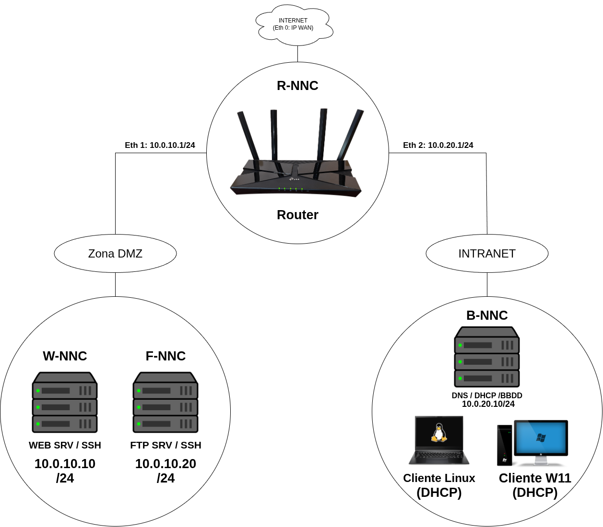
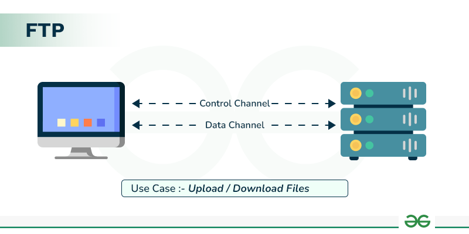

# Projecte-Zero

Proyecto **P0.0 – Desplegament de la infraestructura** del grupo ASIXc2C-G05: despliegue de una infraestructura de red multicapa (WAN, DMZ e INTRANET) para el dominio `sitioitb.cat`, con servicios web, FTP, base de datos, DNS y DHCP.



> Las credenciales que aparecen en este documento (`bchecker` / `bchecker121`) son las que fija el enunciado y se usan **solo en el entorno de laboratorio**.

## Cómo leer esta documentación

La documentación está separada según quién la va a leer:

| Perfil | Qué encontrará | Sección |
| :--- | :--- | :--- |
| Técnico / evaluador | Objetivos, análisis de necesidades, elección de tecnologías, arquitectura, seguridad y criterios de rendimiento y disponibilidad | [Documentación técnica](#documentación-técnica) |
| Administrador de sistemas | Instalación y configuración de cada equipo, dependencias, mantenimiento y resolución de problemas | [Documentación de administrador](#documentación-de-administrador) |
| Cliente (usuario final) | Cómo conectarse a la red, usar la web y el FTP, y qué hacer si algo falla | [Documentación de cliente](#documentación-de-cliente) |
| Equipo y profesorado | Juego de pruebas, planificación, recursos, control de tareas y riesgos | [Plan de pruebas](#plan-de-pruebas) y [Gestión del proyecto](#gestión-del-proyecto) |

## Índice

- [Documentación técnica](#documentación-técnica)
  - [Objetivos y destinatarios](#objetivos-y-destinatarios)
  - [Análisis de necesidades](#análisis-de-necesidades)
  - [Estudio de tecnologías](#estudio-de-tecnologías)
  - [Arquitectura de red](#arquitectura-de-red)
  - [Direccionamiento IP](#direccionamiento-ip)
  - [Firewall y conexiones](#firewall-y-conexiones)
  - [Medidas de seguridad](#medidas-de-seguridad)
  - [Criterios de rendimiento y disponibilidad](#criterios-de-rendimiento-y-disponibilidad)
- [Documentación de administrador](#documentación-de-administrador)
  - [Orden de despliegue y dependencias](#orden-de-despliegue-y-dependencias)
  - [Router R-NNC](#router-r-nnc)
  - [Servidor web W-NNC](#servidor-web-w-nnc)
  - [Servidor FTP F-NNC](#servidor-ftp-f-nnc)
  - [Servidor B-NNC (BBDD, DNS, DHCP y SSH)](#servidor-b-nnc-bbdd-dns-dhcp-y-ssh)
  - [Clientes de la INTRANET](#clientes-de-la-intranet)
  - [Control de versiones con Git y GitHub](#control-de-versiones-con-git-y-github)
  - [Mantenimiento](#mantenimiento)
  - [Resolución de problemas](#resolución-de-problemas)
- [Documentación de cliente](#documentación-de-cliente)
  - [Servicios disponibles](#servicios-disponibles)
  - [Conectar el equipo a la red](#conectar-el-equipo-a-la-red)
  - [Usar la web](#usar-la-web)
  - [Instalar el cliente FTP](#instalar-el-cliente-ftp)
  - [Usar el FTP](#usar-el-ftp)
  - [Buenas prácticas](#buenas-prácticas)
  - [Si algo no funciona](#si-algo-no-funciona)
- [Plan de pruebas](#plan-de-pruebas)
- [Gestión del proyecto](#gestión-del-proyecto)
- [Fuentes y documentación de referencia](#fuentes-y-documentación-de-referencia)
- [Estructura del repositorio](#estructura-del-repositorio)

## Documentación técnica

Explica qué problema resuelve el proyecto, por qué se ha elegido cada tecnología y cómo se cubren la seguridad, el rendimiento y la disponibilidad.

### Objetivos y destinatarios

**Problema.** Hay que publicar una aplicación web que consulta los datos de equipamientos educativos de Barcelona (Open Data BCN) y un servicio de intercambio de ficheros, sin poner en riesgo la red interna ni la base de datos donde están esos datos.

**Objetivos:**

- Segmentar la red en tres zonas (WAN, DMZ e INTRANET) con un router-cortafuegos que controle todo el tráfico entre ellas.
- Publicar en la DMZ los servicios accesibles desde fuera: web (`W-NNC`) y FTP (`F-NNC`).
- Mantener en la INTRANET los servicios internos: MySQL, DNS y DHCP (`B-NNC`).
- Cargar en MySQL el conjunto de datos de equipamientos educativos de Open Data BCN y mostrarlo en la web.
- Administrar todos los servidores por SSH desde la INTRANET y versionar la configuración y la documentación en GitHub.

**Destinatarios:**

- Usuarios de la INTRANET (puestos Linux y Windows 11): usan la web y el FTP, y reciben la configuración de red automáticamente.
- Visitantes de Internet: solo pueden llegar a los servicios publicados en la DMZ.
- Administradores: despliegan y mantienen la infraestructura.

### Análisis de necesidades

| Necesidad | Solución adoptada |
| :--- | :--- |
| Publicar servicios sin exponer la red interna | DMZ separada (`10.0.10.0/24`) y política de denegar por defecto en `R-NNC` |
| Proteger la base de datos | MySQL en la INTRANET; desde la DMZ solo `W-NNC` llega al puerto `3306/tcp` |
| Intercambiar ficheros con usuarios autenticados | FTP con `vsftpd`, sin acceso anónimo, con lista blanca, chroot y FTPS |
| Resolver los nombres de la organización | DNS BIND 9 con la zona `sitioitb.cat` y sus zonas inversas |
| Configurar los puestos sin intervención manual | DHCP con `isc-dhcp-server` en la INTRANET |
| Dar salida a Internet a las redes privadas | NAT (`masquerade`) en la interfaz WAN de `R-NNC` |
| Administrar los equipos en remoto | SSH en todos los equipos, accesible solo desde la INTRANET |
| Saber qué se ha cambiado y cuándo | Repositorio Git en GitHub con la configuración y la documentación |

### Estudio de tecnologías

Todo el software es libre y se instala desde los repositorios oficiales de la distribución.

| Servicio | Tecnología elegida | Alternativas | Motivo de la elección |
| :--- | :--- | :--- | :--- |
| Cortafuegos y NAT | `nftables` | `iptables`, pfSense, OPNsense | `nftables` sustituye a `iptables` en Linux: una sola herramienta para filtrado y NAT, con conjuntos (`{ 80, 443 }`) y variables (`define`) que hacen las reglas más legibles. pfSense y OPNsense son distribuciones completas de cortafuegos; aquí el router ya es un Linux y basta con el filtrado del kernel. |
| Web | `nginx` | Apache HTTP Server | Arquitectura basada en eventos con poco consumo de memoria para servir contenido estático, y configuración centralizada sin ficheros `.htaccess`. |
| FTP | `vsftpd` | ProFTPD, Pure-FTPd, SFTP (OpenSSH) | Está en los repositorios oficiales de Ubuntu, su diseño prioriza la seguridad (chroot y separación de privilegios) y soporta FTPS. SFTP es un protocolo distinto que funciona sobre SSH; el proyecto pide un servidor FTP. |
| DNS | BIND 9 | dnsmasq, Unbound | Hace de servidor autoritativo y recursivo a la vez, con zonas directas e inversas en ficheros estándar. dnsmasq está pensado para redes pequeñas y Unbound solo es recursivo. |
| DHCP | `isc-dhcp-server` | Kea, dnsmasq | Configuración sencilla y muy documentada. ISC ya no lo mantiene y recomienda Kea (ver [riesgos](#riesgos-técnicos-y-mejoras)). |
| Base de datos | MySQL 8 | MariaDB, PostgreSQL | Permite cargar el CSV directamente con `LOAD DATA LOCAL INFILE`. |
| Configuración de red | Netplan (servidores), `ifupdown` (router) | NetworkManager, systemd-networkd | Netplan es el sistema por defecto de Ubuntu Server; el router usa `/etc/network/interfaces`. |
| Control de versiones | Git y GitHub | GitLab, Gitea | Repositorio compartido del equipo, con autenticación por clave SSH (deploy key) desde los servidores. |

#### Alternativas comerciales

| Necesidad | Servicio | Empresa | Por qué no se usa |
| :--- | :--- | :--- | :--- |
| Cortafuegos perimetral | FortiGate | Fortinet | Hardware y licencias de pago; el proyecto consiste en montar el cortafuegos con Linux. |
| DNS gestionado | Route 53 | Amazon Web Services | Pago por uso y la zona queda fuera de la infraestructura propia. |
| Transferencia de ficheros gestionada | AWS Transfer Family (SFTP, FTPS y FTP) | Amazon Web Services | Pago por uso; los ficheros se guardarían en la nube del proveedor. |
| Base de datos gestionada | Azure Database for MySQL | Microsoft | Pago por uso y dependencia del proveedor. |

En todos los casos el proyecto consiste en desplegar y administrar los servicios en máquinas virtuales propias, así que se descartan las opciones gestionadas.

### Arquitectura de red

La red se organiza alrededor del router `R-NNC`, con una interfaz para cada zona. En el esquema las interfaces aparecen como `Eth 0`, `Eth 1` y `Eth 2`; en la tabla está su nombre real en el sistema.

#### Router y cortafuegos (`R-NNC`)

Es el elemento central de encaminamiento y la frontera de seguridad entre Internet y las redes privadas.

| Interfaz (esquema) | Interfaz (sistema) | IP | Red |
| :--- | :--- | :--- | :--- |
| `Eth 0` | `enp1s0` | DHCP | WAN / Internet (sale con NAT) |
| — | `enp2s0` | — | Reservada para una VPN WireGuard (no se usa) |
| `Eth 1` | `enp3s0` | `10.0.10.1/24` | Puerta de enlace de la DMZ |
| `Eth 2` | `enp4s0` | `10.0.20.1/24` | Puerta de enlace de la INTRANET |

Separa el tráfico público del privado y aplica las reglas del cortafuegos, de forma que un servidor de la DMZ comprometido no pueda llegar a la red privada.

#### Zona DMZ (`10.0.10.0/24`)

Aísla los servidores que tienen que ser accesibles desde fuera, para limitar el impacto de una posible vulnerabilidad.

- **Servidor web `W-NNC` (`10.0.10.10/24`):** nginx y SSH. Aloja contenido público, así que está separado de la base de datos y de los clientes. Muestra la aplicación que consulta los datos de equipamientos educativos de Barcelona.
- **Servidor FTP `F-NNC` (`10.0.10.20/24`):** vsftpd y SSH. El servicio de ficheros queda fuera de la INTRANET para que un problema en él no se propague a la red local.

#### Zona INTRANET (`10.0.20.0/24`)

Es el núcleo privado: servicios de infraestructura interna y equipos de usuario.

- **Servidor `B-NNC` (`10.0.20.10/24`):** MySQL, DNS, DHCP y SSH. La base de datos queda protegida de accesos directos desde Internet y desde la DMZ; solo el servidor web la consulta por el puerto `3306`. DHCP da IP, máscara, puerta de enlace y DNS a los clientes; DNS resuelve los nombres locales y reenvía el resto a servidores externos.
- **Cliente Linux (`PC-Linux`):** configuración por DHCP, recibe una IP del rango `10.0.20.100`-`10.0.20.200`.
- **Cliente Windows 11 (`PC-W11`):** configuración por DHCP. Sirve para comprobar que DHCP, DNS y la web funcionan también con Windows.

### Direccionamiento IP

| Zona | Subred / rango | Propósito | Máquinas |
| :--- | :--- | :--- | :--- |
| WAN / NAT | Asignada por el proveedor | Salida a Internet | Interfaz `enp1s0` de `R-NNC` |
| DMZ | `10.0.10.0/24` | Servicios públicos | `W-NNC` (`10.0.10.10`) y `F-NNC` (`10.0.10.20`) |
| INTRANET | `10.0.20.0/24` | Infraestructura y puestos de trabajo | `B-NNC` (`10.0.20.10`), `PC-Linux` y `PC-W11` |

| Hostname | Zona | IP / subred | Servicios | Notas y credenciales |
| :--- | :--- | :--- | :--- | :--- |
| `R-NNC` | WAN, DMZ e INTRANET | WAN: DHCP; DMZ: `10.0.10.1/24`; INTRANET: `10.0.20.1/24` | Enrutamiento, NAT y cortafuegos | El DNS resuelve `R-NNC`, `R-NCC` y `R` a este equipo |
| `W-NNC` | DMZ | `10.0.10.10/24` | Web, SSH | Usuario `bchecker` / `bchecker121` |
| `F-NNC` | DMZ | `10.0.10.20/24` | FTP/FTPS, SSH | Usuario `bchecker` / `bchecker121` |
| `B-NNC` | INTRANET | `10.0.20.10/24` | MySQL, DNS, DHCP, SSH | Importa el CSV de datos. Usuario `bchecker` / `bchecker121` |
| `PC-W11` | INTRANET | Dinámica (DHCP) | Cliente Windows | IP del rango `10.0.20.100`-`10.0.20.200` |
| `PC-Linux` | INTRANET | Dinámica (DHCP) | Cliente Linux | IP del rango `10.0.20.100`-`10.0.20.200` |

#### Flujo de interconexión

- **Resolución de nombres:** el DNS de `B-NNC` resuelve `R-NNC`, `R-NCC` y `R` hacia la IP del router, y `ftp` y `www` hacia los servidores de la DMZ.
- **Web a base de datos:** la aplicación de `W-NNC` (`10.0.10.10`) consulta MySQL en `B-NNC` (`10.0.20.10`) por el puerto `3306`, cruzando el router.
- **Clientes a la DMZ:** los puestos de la INTRANET llegan a la web y al FTP a través de `R-NNC`.
- **Administración:** todas las máquinas tienen la cuenta `bchecker` para administrarlas por SSH desde la INTRANET.

### Firewall y conexiones

Matriz de conectividad entre zonas (origen en filas, destino en columnas). La política por defecto del router es **denegar** todo lo que no esté permitido, y siempre se acepta el tráfico de respuesta de conexiones ya establecidas (`ESTABLISHED, RELATED`).

| Origen \ Destino | Internet | DMZ | INTRANET |
| :--- | :---: | :---: | :---: |
| **Internet** | - | Solo servicios publicados (HTTP/HTTPS a `W-NNC`, FTP a `F-NNC`) | No |
| **DMZ** | Limitado (DNS, NTP, HTTP/HTTPS y ping) | - | Solo `W-NNC` → `B-NNC` (`3306/tcp`) |
| **INTRANET** | Sí (con NAT) | Sí (web, FTP y SSH) | - |

Justificación de las reglas:

- **Internet → DMZ (restringido):** solo se exponen los puertos de los servicios públicos. El resto, SSH incluido, no es accesible desde fuera.
- **Internet → INTRANET (no):** la red privada no es accesible desde fuera y además está detrás de NAT.
- **DMZ → INTRANET (solo `W-NNC` → `B-NNC` por `3306/tcp`):** es la única excepción, porque la web consulta MySQL. Cualquier otro intento desde la DMZ hacia la red privada se bloquea.
- **INTRANET → Internet (sí, con NAT):** los clientes necesitan salida a Internet y `B-NNC` necesita reenviar consultas DNS externas y descargar paquetes.
- **INTRANET → DMZ (sí):** los clientes usan la web y el FTP, y los servidores de la DMZ se administran por SSH desde aquí.
- **DMZ → Internet (limitado):** solo DNS, NTP, HTTP/HTTPS y ping, lo necesario para resolver nombres, sincronizar la hora e instalar actualizaciones.

Puertos de cada servicio:

| Servicio | Puerto | Equipo | Accesible desde |
| :--- | :--- | :--- | :--- |
| Web | `80/tcp` | `W-NNC` | Internet e INTRANET |
| FTP (control) | `21/tcp` | `F-NNC` | Internet e INTRANET |
| FTP (datos, modo pasivo) | `40000-40100/tcp` | `F-NNC` | Internet e INTRANET |
| MySQL | `3306/tcp` | `B-NNC` | `W-NNC` e INTRANET |
| DNS | `53/udp` y `53/tcp` | `B-NNC` | INTRANET |
| DHCP | `67/udp` | `B-NNC` | INTRANET |
| SSH | `22/tcp` | Todos | INTRANET |

### Medidas de seguridad

- **Segmentación:** los servicios públicos están en la DMZ y los datos y la infraestructura interna en la INTRANET.
- **Cortafuegos con estado y denegar por defecto:** `R-NNC` solo deja pasar lo que está permitido de forma explícita, y el tráfico de respuesta se acepta por el estado de la conexión.
- **Mínima exposición:** desde Internet solo se ven los puertos de la web y del FTP; SSH no se publica.
- **Base de datos aislada:** desde la DMZ solo `W-NNC` llega a MySQL, y solo al puerto `3306`.
- **FTP endurecido:** sin acceso anónimo, lista blanca de usuarios, cada usuario encerrado en su home (chroot) y cifrado TLS disponible (FTPS).
- **Administración:** SSH solo desde la INTRANET, también para el propio router.
- **GitHub sin contraseñas:** los servidores se autentican con una clave SSH propia.

Los puntos débiles conocidos y cómo corregirlos están en [Riesgos técnicos y mejoras](#riesgos-técnicos-y-mejoras).

### Criterios de rendimiento y disponibilidad

#### Capacidad según la configuración

Límites que se deducen de la configuración desplegada:

| Servicio | Parámetro | Valor | Capacidad resultante |
| :--- | :--- | :--- | :--- |
| Web | `worker_connections` (sin `worker_processes`, que por defecto vale 1) | `1024` | Hasta unas 1024 conexiones simultáneas |
| FTP | `pasv_min_port` y `pasv_max_port` | `40000`-`40100` | 101 puertos: como máximo 101 transferencias pasivas a la vez |
| FTP | `max_clients` y `max_per_ip` | Sin definir (`0`) | Sin límite de clientes (ver riesgos) |
| DHCP | `range` | `10.0.20.100`-`10.0.20.200` | 101 direcciones para clientes |
| DHCP | `default-lease-time` / `max-lease-time` | `600` / `7200` s | Concesiones de 10 minutos (máximo 2 horas) |
| DNS | `$TTL` | `86400` s | Los clientes guardan las respuestas hasta 24 horas: un cambio de IP puede tardar ese tiempo en verse |

#### Objetivos medibles

Objetivos para el entorno de laboratorio. Cada uno se comprueba con una prueba del [plan de pruebas](#plan-de-pruebas), donde se anota el valor medido.

| Criterio | Objetivo | Prueba |
| :--- | :--- | :--- |
| Tiempo de respuesta de la web desde la INTRANET | Código `200` en menos de 0,2 s | R1 |
| Tiempo de respuesta del DNS para la zona local | Menos de 50 ms | R2 |
| Velocidad de transferencia FTP (fichero de 100 MB) | 10 MB/s o más | R3 |
| Consulta a MySQL desde `W-NNC` | Menos de 1 s | R4 |
| Obtención de IP por DHCP | Menos de 10 s | R5 |
| Servicios disponibles tras reiniciar un servidor | Arrancan solos en menos de 2 minutos | C1 |
| Recuperación del FTP tras una caída | Vuelve a funcionar al arrancar el servicio | C2 |
| Restauración de la base de datos desde una copia | Mismo número de filas que el original | C4 |

#### Análisis de disponibilidad

En esta fase no hay redundancia: cada servicio está en un solo equipo.

- **`R-NNC` es un punto único de fallo.** Si cae, la INTRANET se queda sin Internet y sin acceso a la DMZ, aunque DNS, DHCP y MySQL siguen funcionando dentro de la INTRANET.
- **`B-NNC` concentra MySQL, DNS y DHCP.** Si cae, la web se queda sin datos, los clientes no resuelven nombres y, cuando caduca la concesión DHCP (600 s por defecto), pierden la IP.
- **Recuperación:** todos los servicios están habilitados para arrancar con el sistema, la configuración completa está en este repositorio y `B-NNC` se puede reconstruir con su script. La base de datos se protege con copias (`mysqldump`, ver [mantenimiento](#mantenimiento)).

## Documentación de administrador

Explica cómo instalar, configurar, comprobar y mantener cada equipo. Los comandos se ejecutan con el usuario `bchecker`, que tiene permisos de `sudo`.

### Orden de despliegue y dependencias

| Orden | Equipo | Sistema | Depende de | Motivo |
| :---: | :--- | :--- | :--- | :--- |
| 1 | `R-NNC` | Pendiente | - | Todas las zonas se comunican y salen a Internet a través de él |
| 2 | `B-NNC` | Ubuntu Server 22.04 LTS | `R-NNC` | Necesita salida a Internet para instalar paquetes y descargar el CSV, y da DNS y DHCP al resto |
| 3 | `W-NNC` | Pendiente | `R-NNC`, `B-NNC` | La web consulta MySQL en `B-NNC` |
| 3 | `F-NNC` | Ubuntu Server 24.04 LTS | `R-NNC`, `B-NNC` | Los clientes llegan a través del router y lo encuentran por nombre gracias al DNS |
| 4 | `PC-Linux`, `PC-W11` | Linux, Windows 11 | `B-NNC` | Reciben IP, puerta de enlace y DNS por DHCP |

> **Pendiente:** indicar el sistema operativo y la versión de `R-NNC` y `W-NNC`.

### Router R-NNC

#### Interfaces de red

Fichero `/etc/network/interfaces`:

```
# This file describes the network interfaces available on your system
# and how to activate them. For more information, see interfaces(5).

source /etc/network/interfaces.d/*

# The loopback network interface
auto lo
iface lo inet loopback

# The primary network interface (INTERNET)
auto enp1s0
iface enp1s0 inet dhcp

#Conexión VPN Wireguard enp2s0 no hace falta

#Conexión DMZ

auto enp3s0
iface enp3s0 inet static
    address 10.0.10.1/24

#Conexión INTRANET

auto enp4s0
iface enp4s0 inet static
    address 10.0.20.1/24
```

Una vez escrita la configuración con `sudo`, se aplica con `sudo systemctl restart networking`.

#### Reenvío de paquetes

```bash
echo "net.ipv4.ip_forward=1" | sudo tee /etc/sysctl.d/99-router.conf
sudo sysctl --system
```

#### Cortafuegos y NAT con nftables

Fichero `/etc/nftables.conf`:

```
#!/usr/sbin/nft -f
flush ruleset

define WAN   = "enp1s0"
define DMZ   = "enp3s0"
define INTRA = "enp4s0"

define WEB  = 10.0.10.10   # W-NNC
define FTP  = 10.0.10.20   # F-NNC
define BNNC = 10.0.20.10   # B-NNC

table inet filter {
    chain input {
        type filter hook input priority filter; policy drop;
        ct state established,related accept
        ct state invalid drop
        iif lo accept
        ip protocol icmp accept
        ip6 nexthdr icmpv6 accept
        iifname $WAN udp sport 67 udp dport 68 accept
        # Administración del router solo desde la intranet
        iifname $INTRA tcp dport 22 accept
    }

    chain forward {
        type filter hook forward priority filter; policy drop;
        ct state established,related accept
        ct state invalid drop

        # Internet -> DMZ: solo los servicios publicados
        iifname $WAN oifname $DMZ ip daddr $WEB tcp dport { 80, 443 } accept
        iifname $WAN oifname $DMZ ip daddr $FTP tcp dport { 21, 40000-40100 } accept

        # Intranet -> DMZ e Internet (incluye SSH a los servidores)
        iifname $INTRA oifname { $WAN, $DMZ } accept

        # DMZ -> BBDD en B-NNC: solo el servidor web y solo ese puerto
        iifname $DMZ oifname $INTRA ip saddr $WEB ip daddr $BNNC tcp dport 3306 accept

        # DMZ -> Internet: solo lo necesario (DNS, NTP, actualizaciones, ping)
        iifname $DMZ oifname $WAN tcp dport { 53, 80, 443 } accept
        iifname $DMZ oifname $WAN udp dport { 53, 123 } accept
        iifname $DMZ oifname $WAN icmp type echo-request accept
    }
}

table ip nat {
    chain prerouting {
        type nat hook prerouting priority dstnat;
        iifname $WAN tcp dport { 80, 443 } dnat to $WEB
        iifname $WAN tcp dport { 21, 40000-40100 } dnat to $FTP
        # SSH desde fuera (opcional, descomenta si lo necesitas):
        # iifname $WAN tcp dport 2210 dnat to $WEB:22
        # iifname $WAN tcp dport 2220 dnat to $FTP:22
    }
    chain postrouting {
        type nat hook postrouting priority srcnat;
        oifname $WAN masquerade
    }
}
```

Se comprueba la sintaxis, se carga la configuración y se habilita el servicio para que las reglas se apliquen también al arrancar:

```bash
sudo nft -c -f /etc/nftables.conf
sudo systemctl restart nftables
sudo systemctl enable nftables
```

#### Comprobación de R-NNC

```bash
ip -br a
sysctl net.ipv4.ip_forward
sudo nft list ruleset
systemctl is-enabled nftables
```

| Comprobación | Resultado esperado |
| :--- | :--- |
| Interfaces | `enp3s0` con `10.0.10.1/24` y `enp4s0` con `10.0.20.1/24` |
| Reenvío | `net.ipv4.ip_forward = 1` |
| Reglas | Aparecen las tablas `inet filter` e `ip nat` |
| Arranque | `enabled` |

### Servidor web W-NNC


> **Pendiente:** documentar el sistema operativo, la configuración de red de `W-NNC` y cómo se conecta la aplicación web a MySQL (lenguaje, fichero de conexión y servicio que la ejecuta). La configuración de nginx de abajo solo sirve ficheros estáticos.

#### Configuración de nginx

```nginx
events {
    worker_connections 1024;
}

http {
    server {
        listen 80;
        listen [::]:80;

        server_name sitioitb.cat;
        root /var/www/html/;
        index web.html web.htm;

        location / {
        try_files $uri $uri/ =404;
        }
    }
}
```

Después de cada cambio se comprueba la sintaxis y se recarga el servicio sin cortar las conexiones abiertas:

```bash
sudo nginx -t
sudo systemctl reload nginx
```

#### Comprobación de W-NNC

```bash
systemctl is-active nginx ssh
curl -I http://10.0.10.10/
nc -zv -w 3 10.0.20.10 3306
```

| Comprobación | Resultado esperado |
| :--- | :--- |
| Servicios | `active` |
| Respuesta HTTP | `HTTP/1.1 200 OK` |
| Acceso a MySQL en `B-NNC` | `succeeded` |

### Servidor FTP F-NNC



| Campo | Valor |
| :--- | :--- |
| Hostname | `f-nnc` (alias `f-ncc` y `f-nnc.sitioitb.cat`) |
| Sistema | Ubuntu Server 24.04 LTS |
| Zona | DMZ `10.0.10.0/24` |
| IP | `10.0.10.20/24` (interfaz `enp2s0`) |
| Puerta de enlace | `R-NNC` (`10.0.10.1`) |
| Servicios | FTP/FTPS (`vsftpd`) y SSH |
| Usuario | `bchecker` / `bchecker121` |

#### Configuración de red de F-NNC

| Interfaz | IP | Uso |
| :--- | :--- | :--- |
| `enp1s0` | DHCP | Salida a Internet (NAT de la plataforma de virtualización) |
| `enp2s0` | `10.0.10.20/24` | DMZ, conectada a `R-NNC` |

Se añade una ruta estática hacia la INTRANET a través del router. Así, los clientes de `10.0.20.0/24` pueden usar el FTP y la respuesta vuelve por `R-NNC` en lugar de intentar salir por otra interfaz.

```yaml
# /etc/netplan/60-static-enp2s0.yaml
network:
  version: 2
  ethernets:
    enp2s0:
      addresses:
        - 10.0.10.20/24
      routes:
        - to: 10.0.20.0/24
          via: 10.0.10.1
```

```bash
sudo chmod 600 /etc/netplan/*.yaml
sudo netplan apply
ip -br a show enp2s0
ping -c2 10.0.10.1
```

#### Sistema base y usuario de F-NNC

```bash
sudo hostnamectl set-hostname f-nnc
sudo sed -i 's/^127\.0\.1\.1.*/127.0.1.1 f-nnc.sitioitb.cat f-nnc f-ncc/' /etc/hosts

sudo useradd -m -s /bin/bash bchecker
echo "bchecker:bchecker121" | sudo chpasswd
sudo usermod -aG sudo bchecker
```

#### Acceso SSH a F-NNC

```bash
sudo apt-get install -y openssh-server
sudo systemctl enable --now ssh
```

Administración remota desde la INTRANET:

```bash
ssh bchecker@10.0.10.20
```

#### Instalación y configuración de vsftpd

```bash
sudo apt-get install -y vsftpd
sudo cp /etc/vsftpd.conf /etc/vsftpd.conf.orig
```

```ini
# /etc/vsftpd.conf  -  F-NNC
listen=NO
listen_ipv6=YES
anonymous_enable=NO
local_enable=YES
write_enable=YES
local_umask=022
dirmessage_enable=YES
use_localtime=YES
xferlog_enable=YES
connect_from_port_20=YES
ftpd_banner=Servidor FTP F-NNC

# Cada usuario encerrado en su home
chroot_local_user=YES
allow_writeable_chroot=YES
secure_chroot_dir=/var/run/vsftpd/empty
pam_service_name=vsftpd

# Modo pasivo (rango abierto/redirigido en el router R-NNC)
pasv_enable=YES
pasv_min_port=40000
pasv_max_port=40100
pasv_address=10.0.10.20

# Solo los usuarios de la lista pueden entrar
userlist_enable=YES
userlist_file=/etc/vsftpd.userlist
userlist_deny=NO

# FTPS explícito opcional (TLS)
ssl_enable=YES
allow_anon_ssl=NO
force_local_logins_ssl=NO
force_local_data_ssl=NO
ssl_tlsv1=YES
ssl_sslv2=NO
ssl_sslv3=NO
require_ssl_reuse=NO
rsa_cert_file=/etc/ssl/certs/ssl-cert-snakeoil.pem
rsa_private_key_file=/etc/ssl/private/ssl-cert-snakeoil.key
```

Alta del usuario en la lista blanca, contenido de prueba y arranque del servicio:

```bash
echo bchecker | sudo tee /etc/vsftpd.userlist

sudo mkdir -p /home/bchecker/ftp
echo "Fitxer de prova F-NNC" | sudo tee /home/bchecker/ftp/benvinguda.txt
sudo chown -R bchecker:bchecker /home/bchecker/ftp

sudo systemctl enable --now vsftpd
sudo systemctl restart vsftpd
```

#### Decisiones de configuración

| Opción | Motivo |
| :--- | :--- |
| `anonymous_enable=NO` | El servidor está en la DMZ, expuesto a Internet: no se permite el acceso anónimo. |
| `chroot_local_user=YES` | Cada usuario queda encerrado en su home y no puede ver el resto del sistema. |
| `allow_writeable_chroot=YES` | vsftpd se niega a encerrar a un usuario en un directorio en el que puede escribir; esta opción lo permite, porque el home de `bchecker` es escribible. |
| `userlist_deny=NO` | Lista blanca: solo entran los usuarios incluidos en `/etc/vsftpd.userlist`. |
| `pasv_min_port` / `pasv_max_port` (`40000`-`40100`) | Rango acotado para poder abrirlo y redirigirlo en el firewall de `R-NNC`. |
| `pasv_address=10.0.10.20` | IP de la DMZ que el servidor anuncia a los clientes en modo pasivo. |
| `ssl_enable=YES` sin forzar | Permite FTPS (TLS explícito) sin impedir el uso de clientes FTP simples. |

Con los clientes de la INTRANET solo funciona el **modo pasivo**: en modo activo es el servidor quien abre la conexión de datos hacia el cliente, y `R-NNC` no deja pasar conexiones iniciadas desde la DMZ hacia la INTRANET.

#### Alta de nuevos usuarios FTP

Para un usuario que solo use el FTP, sin shell interactiva:

```bash
sudo useradd -m -s /usr/sbin/nologin usuario2
sudo passwd usuario2
echo usuario2 | sudo tee -a /etc/vsftpd.userlist
sudo mkdir -p /home/usuario2/ftp
sudo chown usuario2:usuario2 /home/usuario2/ftp
```

- Hay que usar `tee -a` (añadir al final). Sin `-a`, `tee` sobrescribe la lista y los usuarios que ya estaban dejan de poder entrar.
- Si `grep pam_shells /etc/pam.d/vsftpd` devuelve una línea, PAM solo deja entrar a usuarios cuya shell aparece en `/etc/shells`. En ese caso hay que añadir `/usr/sbin/nologin` a ese fichero: `grep -x /usr/sbin/nologin /etc/shells || echo /usr/sbin/nologin | sudo tee -a /etc/shells`.

#### Comprobación de F-NNC

Desde un cliente de la INTRANET:

```bash
# Listar y descargar
curl -u bchecker:bchecker121 ftp://10.0.10.20/ftp/
curl -u bchecker:bchecker121 ftp://10.0.10.20/ftp/benvinguda.txt

# Subida por FTPS (-k acepta el certificado autofirmado)
curl --ssl-reqd -k -u bchecker:bchecker121 -T fitxer.txt ftp://10.0.10.20/ftp/

# Acceso anónimo (debe fallar)
curl ftp://10.0.10.20/
```

En el propio servidor:

```bash
hostname
ip r | grep 10.0.20
ss -ltnp | grep -E ':(21|22)\s'
systemctl is-active vsftpd ssh
```

| Prueba | Resultado esperado |
| :--- | :--- |
| Inicio de sesión de `bchecker` y listado | Correcto |
| Descarga de `benvinguda.txt` | Correcto |
| Subida con FTPS (TLS) | Correcto |
| Acceso anónimo | Rechazado |
| Chroot (en `/` solo se ve `ftp/`) | Correcto |
| Puertos 21 y 22 escuchando | Correcto |
| Ping al router `10.0.10.1` | Correcto |

#### Dependencias de F-NNC con otros equipos

| Equipo | Requisito |
| :--- | :--- |
| `R-NNC` | El firewall debe permitir y redirigir `21/tcp` y `40000-40100/tcp` hacia `10.0.10.20`. |
| `B-NNC` | El DNS debe resolver `f-nnc` y `f-ncc` hacia `10.0.10.20`, y definir `ftp IN CNAME f-nnc`. |

El certificado TLS es el autofirmado de Ubuntu (`snakeoil`), por lo que los clientes mostrarán un aviso al usar FTPS. Para que puedan comprobar que el certificado es el bueno, el administrador les facilita su huella SHA-256:

```bash
openssl x509 -in /etc/ssl/certs/ssl-cert-snakeoil.pem -noout -fingerprint -sha256
```

### Servidor B-NNC (BBDD, DNS, DHCP y SSH)


`B-NNC` es una máquina Ubuntu Server 22.04 (jammy) en la INTRANET, con MySQL, DNS, DHCP y SSH en el mismo sistema. Su interfaz `enp3s0` va conectada a la interfaz de la INTRANET del router (`enp4s0`, `10.0.20.1`).

El enunciado usa `B-NNC` y `B-NCC` indistintamente, por eso en `/etc/hosts` y en el DNS están los dos nombres.

#### Script automático

Todo lo de esta sección está recogido en un script que se ejecuta con `sudo bash b-nnc.sh` (está en `scripts/b-nnc.sh`). Instala los paquetes, configura los servicios, descarga y carga el CSV, deja la IP fija y al final hace una batería de comprobaciones con `[OK]` / `[FAIL]`. Se puede ejecutar varias veces sin problema. Abajo está explicado paso a paso lo que hace.

> **Pendiente:** la carpeta `scripts/` todavía no está en el repositorio. Hay que subir `b-nnc.sh` antes de la entrega.

#### Sistema base y usuario de B-NNC

```bash
sudo hostnamectl set-hostname b-nnc
echo "127.0.1.1 b-nnc.sitioitb.cat b-nnc b-ncc" | sudo tee -a /etc/hosts

sudo useradd -m -s /bin/bash bchecker
echo "bchecker:bchecker121" | sudo chpasswd
sudo usermod -aG sudo bchecker
```

Paquetes (los servicios ya venían instalados, solo había que configurarlos):

```bash
sudo apt-get update
sudo apt-get install -y openssh-server bind9 bind9utils dnsutils isc-dhcp-server mysql-server git curl python3
```

#### Red estática

Fichero `/etc/netplan/01-b-nnc.yaml`:

```yaml
network:
  version: 2
  ethernets:
    enp3s0:
      dhcp4: no
      addresses: [10.0.20.10/24]
      routes:
        - to: default
          via: 10.0.20.1
      nameservers:
        addresses: [127.0.0.1]
        search: [sitioitb.cat]
```

```bash
sudo chmod 600 /etc/netplan/01-b-nnc.yaml
sudo netplan apply
ip -br a show enp3s0
ping -c2 10.0.20.1
```

Mientras tenía la IP por DHCP salía a Internet para instalar paquetes. Al poner la IP fija, la salida depende del router (ver [problemas encontrados](#problemas-encontrados-durante-el-despliegue)).

#### Acceso SSH a B-NNC

```bash
sudo systemctl enable --now ssh
systemctl status ssh
```

Se entra con `bchecker`. Para GitHub se usa otra clave distinta, explicada en [Control de versiones](#control-de-versiones-con-git-y-github).

#### DNS (bind9)

En Ubuntu 22.04 el servicio se llama `named` (`bind9` es solo un alias). El requisito del enunciado es que resuelva `R-NCC` y `R` hacia el router.

`/etc/bind/named.conf.options`:

```
options {
    directory "/var/cache/bind";
    listen-on { 127.0.0.1; 10.0.20.10; };
    allow-query { 127.0.0.1; 10.0.10.0/24; 10.0.20.0/24; };
    recursion yes;
    allow-recursion { 127.0.0.1; 10.0.10.0/24; 10.0.20.0/24; };
    forwarders { 8.8.8.8; 1.1.1.1; };
    dnssec-validation no;
};
```

`/etc/bind/named.conf.local`:

```
zone "sitioitb.cat" { type master; file "/etc/bind/db.sitioitb.cat"; };
zone "20.0.10.in-addr.arpa" { type master; file "/etc/bind/db.10.0.20"; };
zone "10.0.10.in-addr.arpa" { type master; file "/etc/bind/db.10.0.10"; };
```

Zona directa `/etc/bind/db.sitioitb.cat`:

```
$TTL 86400
@      IN SOA b-nnc.sitioitb.cat. admin.sitioitb.cat. ( 1 3600 900 604800 86400 )
@      IN NS  b-nnc.sitioitb.cat.
@      IN A   10.0.10.10
r      IN A   10.0.20.1
r-nnc  IN A   10.0.20.1
r-ncc  IN A   10.0.20.1
b-nnc  IN A   10.0.20.10
b-ncc  IN A   10.0.20.10
w-nnc  IN A   10.0.10.10
w-ncc  IN A   10.0.10.10
f-nnc  IN A   10.0.10.20
f-ncc  IN A   10.0.10.20
www    IN CNAME w-nnc
ftp    IN CNAME f-nnc
```

Las zonas inversas (`db.10.0.20` y `db.10.0.10`) tienen los registros PTR de `r-nnc`, `b-nnc`, `w-nnc` y `f-nnc`.

Un comodín tipo `*-nnc` no vale en DNS (el asterisco solo funciona como etiqueta completa), por eso los hosts están puestos uno a uno.

```bash
sudo named-checkconf
sudo named-checkzone sitioitb.cat /etc/bind/db.sitioitb.cat
sudo systemctl enable --now named
sudo systemctl restart named
```

#### DHCP (isc-dhcp-server)

`/etc/default/isc-dhcp-server`:

```
INTERFACESv4="enp3s0"
```

`/etc/dhcp/dhcpd.conf`:

```
authoritative;
default-lease-time 600;
max-lease-time 7200;

subnet 10.0.20.0 netmask 255.255.255.0 {
    range 10.0.20.100 10.0.20.200;
    option routers 10.0.20.1;
    option domain-name-servers 10.0.20.10;
    option domain-name "sitioitb.cat";
    option broadcast-address 10.0.20.255;
}
```

```bash
sudo dhcpd -t -cf /etc/dhcp/dhcpd.conf
sudo systemctl enable --now isc-dhcp-server
```

Los clientes reciben IP entre `10.0.20.100` y `10.0.20.200`, puerta de enlace `10.0.20.1` y DNS `10.0.20.10`.

#### MySQL y carga del CSV

MySQL 8. Para que la web de `W-NNC` pueda conectar, MySQL escucha en todas las interfaces. En `/etc/mysql/mysql.conf.d/mysqld.cnf`:

```ini
bind-address = 0.0.0.0
```

```bash
sudo systemctl enable --now mysql
sudo systemctl restart mysql
```

Base de datos y usuario (acceso desde local, DMZ e INTRANET):

```sql
SET GLOBAL local_infile = 1;
CREATE DATABASE equipaments CHARACTER SET utf8mb4;
CREATE USER 'bchecker'@'localhost' IDENTIFIED BY 'bchecker121';
CREATE USER 'bchecker'@'10.0.10.%' IDENTIFIED BY 'bchecker121';
CREATE USER 'bchecker'@'10.0.20.%' IDENTIFIED BY 'bchecker121';
GRANT ALL PRIVILEGES ON equipaments.* TO 'bchecker'@'localhost';
GRANT ALL PRIVILEGES ON equipaments.* TO 'bchecker'@'10.0.10.%';
GRANT ALL PRIVILEGES ON equipaments.* TO 'bchecker'@'10.0.20.%';
FLUSH PRIVILEGES;
```

CSV: listado de equipamientos de educación de la ciudad de Barcelona (Open Data BCN).

```bash
curl -L -o /tmp/equip.csv "https://opendata-ajuntament.barcelona.cat/data/dataset/f36b60f2-9541-4d08-b0f9-b0a9313fab3d/resource/29d9ff10-6892-4f16-9012-d5c4997857e7/download"
```

El fichero viene en UTF-16, así que antes de cargarlo hay que pasarlo a UTF-8 y limpiarlo:

```bash
iconv -f UTF-16 -t UTF-8 /tmp/equip.csv -o /tmp/equip_utf8.csv
mv /tmp/equip_utf8.csv /tmp/equip.csv
sed -i '1s/^\xEF\xBB\xBF//; s/\r$//' /tmp/equip.csv
```

La cabecera es `register_id,name,institution_id,institution_name,created,modified,addresses_roadtype_id,...`. Como el CSV tiene muchas columnas, un pequeño script de Python lee la cabecera, crea la tabla con todas las columnas como `TEXT` y genera el `LOAD DATA`:

```bash
python3 - <<'PY'
import csv, re
f = open('/tmp/equip.csv', encoding='utf-8')
hdr = next(csv.reader(f))
cols = []
for h in hdr:
    c = re.sub(r'[^a-z0-9]+', '_', h.strip().lower()).strip('_') or 'col'
    while c in cols:
        c += '_2'
    cols.append(c)
defs = ", ".join("`%s` TEXT" % c for c in cols)
names = ",".join("`%s`" % c for c in cols)
sql = "DROP TABLE IF EXISTS equipaments;\n"
sql += "CREATE TABLE equipaments (id INT AUTO_INCREMENT PRIMARY KEY, %s) CHARACTER SET utf8mb4;\n" % defs
sql += "LOAD DATA LOCAL INFILE '/tmp/equip.csv' INTO TABLE equipaments CHARACTER SET utf8mb4 "
sql += "FIELDS TERMINATED BY ',' OPTIONALLY ENCLOSED BY '\"' LINES TERMINATED BY '\\n' IGNORE 1 ROWS (%s);\n" % names
open('/tmp/load.sql', 'w').write(sql)
PY

mysql --local-infile=1 equipaments < /tmp/load.sql
```

#### Comprobación de B-NNC

Servicios y puertos:

```bash
systemctl is-active ssh named isc-dhcp-server mysql
ss -tln | grep -E ':22 |:3306 '
ss -uln | grep -E ':53 |:67 '
```

Red:

```bash
ip -br a show enp3s0      # 10.0.20.10/24
ping -c2 10.0.20.1        # router
ping -c2 8.8.8.8          # salida a Internet
ping -c2 google.com       # DNS recursivo
```

DNS:

```bash
dig +short r.sitioitb.cat @10.0.20.10        # 10.0.20.1
dig +short r-ncc.sitioitb.cat @10.0.20.10    # 10.0.20.1
dig +short w-nnc.sitioitb.cat @10.0.20.10    # 10.0.10.10
dig +short -x 10.0.20.1 @10.0.20.10          # r-nnc.sitioitb.cat.
```

DHCP: arrancar `PC-Linux` y `PC-W11` en la INTRANET y comprobar que reciben IP entre `10.0.20.100` y `10.0.20.200`, puerta de enlace `10.0.20.1` y DNS `10.0.20.10` (ver [Clientes de la INTRANET](#clientes-de-la-intranet)). Las concesiones se ven en `/var/lib/dhcp/dhcpd.leases`.

MySQL:

```bash
mysql -e "SELECT COUNT(*) FROM equipaments.equipaments;"
mysql -h 10.0.20.10 -u bchecker -pbchecker121 equipaments -e "SELECT name FROM equipaments LIMIT 5;"
```

Desde `W-NNC`, la aplicación web tiene que poder conectar a `10.0.20.10:3306` y mostrar el contenido de la tabla `equipaments`.

### Clientes de la INTRANET

`PC-Linux` y `PC-W11` no necesitan configuración manual: lo reciben todo por DHCP desde `B-NNC`.

| Equipo | Comando | Resultado esperado |
| :--- | :--- | :--- |
| `PC-Linux` | `ip -br a` y `resolvectl status` | IP entre `10.0.20.100` y `10.0.20.200`; DNS `10.0.20.10` |
| `PC-W11` | `ipconfig /all` | IP entre `10.0.20.100` y `10.0.20.200`; puerta de enlace `10.0.20.1`; DNS `10.0.20.10` |

Para el uso de la web y del FTP desde estos equipos, ver la [documentación de cliente](#documentación-de-cliente).

### Control de versiones con Git y GitHub

El proyecto está en un repositorio de GitHub. El servidor `B-NNC` se autentica con un par de claves pública/privada, sin contraseñas.

#### Autenticación por clave SSH

En el servidor, con el usuario `bchecker`:

```bash
ssh-keygen -t ed25519 -C "b-nnc" -N "" -f ~/.ssh/id_ed25519
cat ~/.ssh/id_ed25519.pub
```

La clave pública (la línea entera que empieza por `ssh-ed25519`) se añade en GitHub, no en la terminal: repositorio, Settings, Deploy keys, Add deploy key, marcando "Allow write access". La clave privada no sale del servidor.

Comprobación:

```bash
ssh-keyscan -t ed25519 github.com >> ~/.ssh/known_hosts
ssh -T git@github.com
```

Tiene que responder con "successfully authenticated".

#### Configuración inicial de Git

```bash
git config --global user.name "bchecker"
git config --global user.email "bchecker@sitioitb.cat"
git config --global init.defaultBranch main
```

#### Comandos principales

| Comando | Para qué sirve |
| :--- | :--- |
| `git clone git@github.com:ITB2526-JosueAmador/Projecte-Zero.git ~/projecte-zero` | Descarga el repositorio la primera vez, en la carpeta `~/projecte-zero` |
| `git status` | Ver qué ha cambiado |
| `git add .` | Preparar los cambios para el commit |
| `git commit -m "mensaje"` | Guardar los cambios en local con un mensaje |
| `git push origin main` | Subir los commits a GitHub |
| `git pull origin main` | Bajar los cambios nuevos de GitHub |
| `git log --oneline` | Ver el historial |

#### Flujo de subida a producción

1. Se editan los ficheros (configuración, documentación, scripts).
2. `git add .` y `git commit -m "descripción del cambio"`.
3. `git push origin main` sube los cambios a GitHub.
4. En el servidor de producción se hace `git pull origin main` para actualizar.

Si el push se rechaza porque hay cambios nuevos en GitHub, primero `git pull --rebase origin main` y luego otra vez `git push`.

Comprobación:

```bash
ssh -T git@github.com
git -C ~/projecte-zero status
git -C ~/projecte-zero push
```

### Mantenimiento

| Tarea | Equipo | Cómo | Cuándo |
| :--- | :--- | :--- | :--- |
| Actualizar paquetes | Todos | `sudo apt-get update` y `sudo apt-get upgrade` | Cada semana |
| Revisar servicios caídos | Todos | `systemctl --failed` | Cada día y después de cada cambio |
| Revisar registros web | `W-NNC` | `/var/log/nginx/access.log` y `/var/log/nginx/error.log` | Cada semana o ante una incidencia |
| Revisar registros FTP | `F-NNC` | `/var/log/vsftpd.log` | Cada semana o ante una incidencia |
| Revisar registros DNS y DHCP | `B-NNC` | `sudo journalctl -u named` y `sudo journalctl -u isc-dhcp-server` | Ante una incidencia |
| Revisar registros MySQL | `B-NNC` | `/var/log/mysql/error.log` | Ante una incidencia |
| Copia de la base de datos | `B-NNC` | `sudo mysqldump equipaments > equipaments_$(date +%F).sql` | Antes de cada cambio y cada semana |
| Añadir o cambiar un registro DNS | `B-NNC` | Editar la zona, subir el número de serie del SOA, `sudo named-checkzone sitioitb.cat /etc/bind/db.sitioitb.cat` y `sudo rndc reload` | Cuando haga falta |
| Alta de un usuario FTP | `F-NNC` | Ver [alta de nuevos usuarios FTP](#alta-de-nuevos-usuarios-ftp) | Cuando lo pida un cliente |
| Regenerar el certificado FTPS | `F-NNC` | `sudo make-ssl-cert generate-default-snakeoil --force-overwrite` y `sudo systemctl restart vsftpd`; después, dar la nueva huella a los clientes | Si cambia el hostname o caduca el certificado |
| Cambiar el cortafuegos | `R-NNC` | Editar `/etc/nftables.conf`, `sudo nft -c -f /etc/nftables.conf` y `sudo systemctl restart nftables` | Cuando haga falta |
| Guardar los cambios de configuración | - | [Flujo de subida a producción](#flujo-de-subida-a-producción) | Después de cada cambio |

### Resolución de problemas

#### Problemas encontrados durante el despliegue

**`systemctl enable bind9` falla.**
Error: `Refusing to operate on alias name or linked unit file: bind9.service`.
Causa: en Ubuntu 22.04 `bind9` es un alias del servicio `named`.
Solución: usar `systemctl enable --now named` (y `restart named`).

**El CSV da error de codificación.**
Error de Python: `UnicodeDecodeError: 'utf-8' codec can't decode byte 0xff`.
Causa: el CSV de Open Data BCN viene en UTF-16.
Solución: convertirlo con `iconv -f UTF-16 -t UTF-8` antes de cargarlo.

**Sin Internet después de poner la IP estática.**
Síntomas: `apt-get update` da `Network is unreachable` y los repositorios no tienen Release file.
Causa: con la IP estática `10.0.20.10` la salida depende del router (`10.0.20.1`), que tiene que reenviar paquetes y hacer NAT.
Solución: comprobar con ping a `10.0.20.1`, `8.8.8.8` y `google.com`. En el router tiene que estar `net.ipv4.ip_forward=1` y la regla `masquerade` de nftables en la interfaz WAN, además de la regla de forward de la INTRANET hacia la WAN.

**Pegar la clave pública en la terminal.**
La línea `ssh-ed25519 AAAA...` no es un comando. Se pega en GitHub (Deploy keys), no en la terminal, porque ahí da `command not found`.

#### Errores habituales

| Síntoma | Causa probable | Solución |
| :--- | :--- | :--- |
| FTP: `500 OOPS: vsftpd: refusing to run with writable root inside chroot()` | El home del usuario es escribible y está activo el chroot | Mantener `allow_writeable_chroot=YES` o quitar el permiso de escritura de la raíz del home |
| FTP: el login funciona pero el listado se queda colgado o da `425` | No llegan las conexiones de datos en modo pasivo | Comprobar que el rango `40000-40100` está permitido en `R-NNC` y que el cliente usa modo pasivo |
| FTP: `530 Permission denied` | El usuario no está en `/etc/vsftpd.userlist` | Añadirlo con `tee -a` y reiniciar `vsftpd` |
| FTP: `530 Login incorrect` | Contraseña incorrecta o shell que no está en `/etc/shells` | Cambiar la contraseña con `sudo passwd` o revisar `pam_shells` (ver [alta de usuarios](#alta-de-nuevos-usuarios-ftp)) |
| FTP: no responde a la INTRANET pero sí al router | Falta la ruta a `10.0.20.0/24` y la respuesta sale por `enp1s0` | Comprobar `ip r` y el fichero de Netplan, y aplicar con `sudo netplan apply` |
| DNS: un cambio en la zona no se ve | No se ha recargado `named` o el cliente tiene la respuesta en caché | `sudo rndc reload`, comprobar con `dig @10.0.20.10` y, en Windows, `ipconfig /flushdns` |
| DHCP: el cliente se queda con una IP `169.254.x.x` | No llega al servidor DHCP | `systemctl status isc-dhcp-server`, revisar `INTERFACESv4` y `sudo journalctl -u isc-dhcp-server` |
| Router: tras reiniciar, la INTRANET no sale a Internet | Reglas no cargadas o reenvío desactivado | `systemctl is-enabled nftables`, `sudo nft list ruleset` y `sysctl net.ipv4.ip_forward` |
| MySQL: `W-NNC` no conecta a `10.0.20.10` | `bind-address`, regla del router o usuario sin permiso desde esa IP | Comprobar que MySQL escucha en el `3306` (`ss -tln`), la regla `3306` en `R-NNC` y `SELECT user, host FROM mysql.user;` |

## Documentación de cliente

Guía para las personas que usan los equipos de la INTRANET. No hacen falta conocimientos técnicos.

### Servicios disponibles

| Servicio | Dirección | Para qué sirve |
| :--- | :--- | :--- |
| Web de equipamientos educativos | `http://sitioitb.cat` | Consultar los equipamientos educativos de Barcelona |
| FTP | `ftp.sitioitb.cat` (puerto 21) | Subir y descargar ficheros con el usuario y la contraseña que da el administrador |
| Red | Automática | El equipo recibe su configuración al conectarse |

### Conectar el equipo a la red

Basta con conectar el equipo a la red de la INTRANET: la dirección IP, la puerta de enlace y el DNS se configuran solos.

Para comprobar que el equipo tiene red:

- **Windows 11:** abrir el Símbolo del sistema, escribir `ipconfig` y comprobar que la "Dirección IPv4" está entre `10.0.20.100` y `10.0.20.200`.
- **Linux:** abrir una terminal, escribir `ip -br a` y comprobar lo mismo.

### Usar la web

Abrir el navegador y escribir la dirección completa `http://sitioitb.cat`. La web muestra los equipamientos educativos de Barcelona guardados en la base de datos.

### Instalar el cliente FTP

Los navegadores actuales ya no abren direcciones `ftp://`, así que hace falta un programa cliente. Se recomienda FileZilla, que es gratuito y funciona en Windows y Linux.

- **Windows 11:** descargar FileZilla Client desde la web oficial, [filezilla-project.org](https://filezilla-project.org/), e instalarlo. Durante la instalación, rechazar cualquier programa adicional que se ofrezca.
- **Linux (Ubuntu o Debian):** instalarlo desde los repositorios oficiales con `sudo apt-get install -y filezilla`.

### Usar el FTP

1. Abrir FileZilla y entrar en el menú **Archivo**, opción **Gestor de sitios**. Pulsar **Nuevo sitio**.
2. Rellenar los datos de la conexión:

   | Campo | Valor |
   | :--- | :--- |
   | Protocolo | FTP |
   | Servidor | `ftp.sitioitb.cat` |
   | Puerto | `21` |
   | Cifrado | FTP explícito sobre TLS |
   | Modo de acceso | Normal |
   | Usuario y contraseña | Los que facilita el administrador |

3. Pulsar **Conectar**.
4. La primera vez aparece un aviso de **certificado desconocido**. Es normal: el servidor usa un certificado propio. Comparar la huella SHA-256 que muestra FileZilla con la que da el administrador; si coincide, marcar la casilla para confiar siempre en el certificado y aceptar.
5. A la izquierda se ven los ficheros del equipo y a la derecha los del servidor. Para subir o bajar un fichero, arrastrarlo de un lado a otro. Los ficheros se guardan en la carpeta `ftp`.

FileZilla usa el modo de transferencia **pasivo** por defecto, que es el único que funciona con este servidor.

**Desde la terminal de Linux** (opcional), con `curl`. Al no poner la contraseña en el comando, `curl` la pide al ejecutarlo:

```bash
# Ver el contenido de la carpeta ftp
curl --ssl-reqd -k -u usuario ftp://ftp.sitioitb.cat/ftp/

# Subir un fichero
curl --ssl-reqd -k -u usuario -T fichero.txt ftp://ftp.sitioitb.cat/ftp/

# Descargar un fichero
curl --ssl-reqd -k -u usuario -O ftp://ftp.sitioitb.cat/ftp/benvinguda.txt
```

### Buenas prácticas

- No guardar la contraseña en equipos compartidos. Si se guarda, FileZilla permite protegerla con una contraseña maestra.
- Mantener FileZilla actualizado. En Windows avisa él mismo; en Linux se actualiza con `sudo apt-get upgrade`.
- El FTP sirve para intercambiar ficheros, no es una copia de seguridad: conviene guardar siempre una copia propia.
- Si la huella del certificado cambia sin que el administrador lo haya avisado, no aceptarlo y comunicarlo.
- Las altas, bajas y cambios de contraseña se piden al administrador.

### Si algo no funciona

| Síntoma | Causa probable | Qué hacer |
| :--- | :--- | :--- |
| El equipo no tiene IP o tiene una que empieza por `169.254` | No recibe la configuración de la red | Comprobar el cable o la conexión de red y renovar la IP: en Windows, `ipconfig /release` y después `ipconfig /renew`; en Linux, desconectar y volver a conectar la red. Si sigue igual, avisar al administrador |
| La web no carga con el nombre pero sí con `http://10.0.10.10` | Falla la resolución de nombres (DNS) | En Windows, ejecutar `ipconfig /flushdns` y volver a probar. Si sigue igual, avisar al administrador |
| La web no carga de ninguna forma | El servidor web o el router no están disponibles | Avisar al administrador |
| FileZilla muestra `530 Login incorrect` o `530 Permission denied` | Usuario o contraseña incorrectos, o el usuario no tiene permiso de FTP | Revisar el usuario, las mayúsculas y la contraseña. Si sigue igual, pedir el alta al administrador |
| FileZilla avisa de un certificado desconocido | El certificado del servidor es propio (autofirmado) | Comprobar la huella con el administrador y aceptarlo |
| FileZilla conecta pero no muestra las carpetas | Se bloquea la conexión de datos | Comprobar que el modo de transferencia es pasivo. Si sigue igual, avisar al administrador |
| No se puede subir un fichero (`553 Could not create file`) | No hay permiso de escritura en esa carpeta | Subir el fichero dentro de la carpeta `ftp` |

## Plan de pruebas

Juego de pruebas para validar la solución. Cada prueba indica desde qué equipo se lanza y el resultado esperado. En la columna **Resultado** se anota lo obtenido y la evidencia (captura o gif). Los comandos de las pruebas funcionales están en la comprobación de cada equipo.

### Pruebas funcionales

| ID | Prueba | Desde | Resultado esperado | Resultado |
| :--- | :--- | :--- | :--- | :--- |
| F1 | Interfaces, reenvío y reglas del router ([comprobación](#comprobación-de-r-nnc)) | `R-NNC` | IPs correctas, `ip_forward = 1`, reglas cargadas | Pendiente |
| F2 | Servicios de `B-NNC` ([comprobación](#comprobación-de-b-nnc)) | `B-NNC` | `ssh`, `named`, `isc-dhcp-server` y `mysql` en estado `active` | Pendiente |
| F3 | Resolución DNS directa e inversa | `PC-Linux` | `r` y `r-ncc` → `10.0.20.1`; `w-nnc` → `10.0.10.10`; `-x 10.0.20.1` → `r-nnc.sitioitb.cat.` | Pendiente |
| F4 | DHCP en Linux y Windows ([clientes](#clientes-de-la-intranet)) | `PC-Linux`, `PC-W11` | IP del rango `10.0.20.100`-`10.0.20.200`, puerta de enlace `10.0.20.1`, DNS `10.0.20.10` | Pendiente |
| F5 | Datos cargados en MySQL | `B-NNC` | `SELECT COUNT(*)` devuelve más de 0 filas | Pendiente |
| F6 | Web ([comprobación](#comprobación-de-w-nnc)) | `PC-Linux` | `HTTP/1.1 200 OK` y la página muestra los datos | Pendiente |
| F7 | FTP: login, listado, descarga y subida con FTPS ([comprobación](#comprobación-de-f-nnc)) | `PC-Linux` | Todo correcto | Pendiente |
| F8 | Salida a Internet con NAT | `PC-Linux` | `ping -c2 8.8.8.8` y `ping -c2 google.com` responden | Pendiente |
| F9 | Acceso a GitHub desde `B-NNC` | `B-NNC` | `ssh -T git@github.com` responde "successfully authenticated" | Pendiente |

### Pruebas de seguridad

| ID | Prueba | Desde y comando | Resultado esperado | Resultado |
| :--- | :--- | :--- | :--- | :--- |
| S1 | La DMZ no llega a la base de datos | `F-NNC`: `nc -zv -w 3 10.0.20.10 3306` | Sin respuesta (timeout) | Pendiente |
| S2 | La web sí llega a la base de datos | `W-NNC`: `nc -zv -w 3 10.0.20.10 3306` | `succeeded` | Pendiente |
| S3 | La DMZ no llega al SSH de la INTRANET | `F-NNC`: `nc -zv -w 3 10.0.20.10 22` | Sin respuesta (timeout) | Pendiente |
| S4 | El SSH del router solo se abre desde la INTRANET | `F-NNC`: `nc -zv -w 3 10.0.10.1 22` | Sin respuesta (timeout) | Pendiente |
| S5 | FTP anónimo rechazado | `PC-Linux`: `curl ftp://10.0.10.20/` | Error `530` | Pendiente |
| S6 | Usuario fuera de la lista blanca rechazado | `PC-Linux`: `curl -u root:prueba ftp://10.0.10.20/` | Error `530` | Pendiente |
| S7 | El chroot impide salir del home | `PC-Linux`: `curl -u bchecker:bchecker121 ftp://10.0.10.20/etc/` | Error `550`: `/etc` no existe dentro del chroot | Pendiente |
| S8 | Solo están abiertos los puertos previstos | `PC-Linux`: `nmap -Pn 10.0.10.10 10.0.10.20` | `W-NNC`: 22 y 80. `F-NNC`: 21 y 22 | Pendiente |
| S9 | FTPS rechaza TLS 1.0 | `PC-Linux`: ver comando debajo | El handshake falla (ver [riesgos](#riesgos-técnicos-y-mejoras)) | Pendiente |

La prueba S8 necesita `nmap` en `PC-Linux` (`sudo apt-get install -y nmap`).

Comando de la prueba S9:

```bash
openssl s_client -connect 10.0.10.20:21 -starttls ftp -tls1 -cipher 'DEFAULT:@SECLEVEL=0'
```

### Pruebas de monitorización

| ID | Prueba | Desde y comando | Resultado esperado | Resultado |
| :--- | :--- | :--- | :--- | :--- |
| M1 | Estado de los servicios | Cada servidor: `systemctl is-active` con sus servicios | Todos `active` | Pendiente |
| M2 | Servicios fallidos | Cada servidor: `systemctl --failed` | `0 loaded units listed.` | Pendiente |
| M3 | Registro de accesos FTP | `F-NNC`: `sudo tail -n 20 /var/log/vsftpd.log` | Aparecen el login y las transferencias de F7 | Pendiente |
| M4 | Registro de accesos web | `W-NNC`: `sudo tail -n 20 /var/log/nginx/access.log` | Aparecen las peticiones de F6 con código `200` | Pendiente |
| M5 | Registro de concesiones DHCP | `B-NNC`: `sudo journalctl -u isc-dhcp-server -n 20` | Aparece `DHCPACK` para los clientes de F4 | Pendiente |

### Pruebas de contingencia

| ID | Prueba | Cómo | Resultado esperado | Resultado |
| :--- | :--- | :--- | :--- | :--- |
| C1 | Reinicio de cada servidor | `sudo reboot` y repetir M1 | Todos los servicios vuelven solos en menos de 2 minutos | Pendiente |
| C2 | Caída y recuperación del FTP | `F-NNC`: `sudo systemctl stop vsftpd`, repetir F7, `sudo systemctl start vsftpd`, repetir F7 | F7 falla con el servicio parado y vuelve a funcionar al arrancarlo | Pendiente |
| C3 | Caída del router | Apagar `R-NNC` y probar desde `PC-Linux` | Los nombres locales y MySQL siguen funcionando; la web, el FTP e Internet no | Pendiente |
| C4 | Copia y restauración de la base de datos | `B-NNC`: comandos de debajo | Mismo número de filas en `equipaments` y en `equipaments_restore` | Pendiente |
| C5 | Caída de `B-NNC` | Apagar `B-NNC` y probar desde `PC-Linux` y `W-NNC` | La web se queda sin datos y no se resuelven nombres; los clientes mantienen la IP hasta que caduca la concesión | Pendiente |

Comandos de la prueba C4:

```bash
sudo mysqldump equipaments > /tmp/equipaments.sql
sudo mysql -e "CREATE DATABASE equipaments_restore CHARACTER SET utf8mb4;"
sudo mysql equipaments_restore < /tmp/equipaments.sql
sudo mysql -e "SELECT COUNT(*) FROM equipaments.equipaments; SELECT COUNT(*) FROM equipaments_restore.equipaments;"
sudo mysql -e "DROP DATABASE equipaments_restore;"
```

### Pruebas de automatización

| ID | Prueba | Cómo | Resultado esperado | Resultado |
| :--- | :--- | :--- | :--- | :--- |
| A1 | Despliegue de `B-NNC` con el script | `B-NNC` recién instalado: `sudo bash scripts/b-nnc.sh` | Todas las comprobaciones en `[OK]` | Pendiente |
| A2 | El script se puede repetir | Volver a ejecutar el script y después `grep -c b-nnc /etc/hosts` | Todo en `[OK]` y el `grep` devuelve `1` (sin líneas duplicadas) | Pendiente |

### Pruebas de rendimiento

| ID | Prueba | Desde y comando | Resultado esperado | Resultado |
| :--- | :--- | :--- | :--- | :--- |
| R1 | Tiempo de respuesta de la web | `PC-Linux`: `curl -o /dev/null -s -w '%{http_code} %{time_total}\n' http://sitioitb.cat/` (10 veces) | `200` y menos de 0,2 s | Pendiente |
| R2 | Tiempo de respuesta del DNS | `PC-Linux`: `dig w-nnc.sitioitb.cat @10.0.20.10` | `Query time` menor de 50 ms | Pendiente |
| R3 | Velocidad FTP | `PC-Linux`: comandos de debajo | 10 MB/s o más (10485760 bytes/s) | Pendiente |
| R4 | Consulta a MySQL desde la web | `W-NNC`: `time mysql -h 10.0.20.10 -u bchecker -pbchecker121 equipaments -e "SELECT COUNT(*) FROM equipaments;"` | Menos de 1 s (requiere el cliente `mysql`) | Pendiente |
| R5 | Tiempo hasta obtener IP | `PC-W11`: `ipconfig /release` y `ipconfig /renew` | Menos de 10 s | Pendiente |

Comandos de la prueba R3 (`curl` muestra la velocidad en bytes por segundo):

```bash
dd if=/dev/zero of=prueba100M.bin bs=1M count=100
curl -s -o /dev/null -w '%{speed_upload}\n' -u bchecker:bchecker121 -T prueba100M.bin ftp://10.0.10.20/ftp/
curl -s -o /dev/null -w '%{speed_download}\n' -u bchecker:bchecker121 ftp://10.0.10.20/ftp/prueba100M.bin
```

## Gestión del proyecto

### Planificación

| Fase | Tareas principales | Responsable | Fecha prevista | Documentado en el repositorio |
| :--- | :--- | :--- | :--- | :--- |
| Análisis y diseño | Esquema de red, direccionamiento, matriz de conexiones y justificación técnica | Pendiente | Pendiente | 19/10/2026 - 29/10/2026 |
| Router `R-NNC` | Interfaces, reenvío, cortafuegos y NAT | Pendiente | Pendiente | 11/11/2026 |
| Servidor web `W-NNC` | nginx y aplicación web | Pendiente | Pendiente | 22/10/2026 (configuración de nginx) |
| Servidor `B-NNC` | MySQL, carga del CSV, DNS, DHCP, SSH y script | Pendiente | Pendiente | 12/11/2026 |
| Servidor FTP `F-NNC` | vsftpd, FTPS, lista blanca y chroot | Pendiente | Pendiente | 23/11/2026 |
| Pruebas | Ejecución del [plan de pruebas](#plan-de-pruebas) y recogida de evidencias | Pendiente | Pendiente | Pendiente |
| Documentación | Documentación técnica, de administrador y de cliente | Pendiente | Pendiente | Continua |

### Recursos

| Máquina | Sistema | Interfaces | Software principal (repositorios oficiales) |
| :--- | :--- | :--- | :--- |
| `R-NNC` | Pendiente | `enp1s0`, `enp2s0` (sin uso), `enp3s0`, `enp4s0` | `nftables` |
| `W-NNC` | Pendiente | Pendiente | `nginx`, `openssh-server` |
| `F-NNC` | Ubuntu Server 24.04 LTS | `enp1s0`, `enp2s0` | `vsftpd`, `openssh-server` |
| `B-NNC` | Ubuntu Server 22.04 LTS | `enp3s0` | `bind9`, `isc-dhcp-server`, `mysql-server`, `openssh-server`, `git` |
| `PC-Linux` | Linux | 1 (DHCP) | Navegador y FileZilla |
| `PC-W11` | Windows 11 | 1 (DHCP) | Navegador y FileZilla |

> **Pendiente:** añadir la plataforma de virtualización y los recursos asignados a cada máquina virtual (vCPU, RAM y disco).

### Control de tareas

Historial de la documentación en el repositorio:

| Fecha | Cambio |
| :--- | :--- |
| 19/10/2026 | Estructura inicial, esquema de red, tabla de direccionamiento, flujo de interconexión y gifs de los servicios |
| 22/10/2026 | Configuración de nginx |
| 29/10/2026 | Firewalls y conexiones, revisión de la justificación técnica y corrección del identificador `R-NNC` |
| 11/11/2026 | Configuración del router y reglas de la DMZ hacia Internet |
| 12/11/2026 | Configuración de `B-NNC` e índice |
| 23/11/2026 | Configuración del servidor FTP |

> **Pendiente:** enlace al tablero de tareas (Kanban) del equipo.

Diario de trabajo:

| Fecha | Miembro | Tarea | Horas | Estado | Evidencia |
| :--- | :--- | :--- | :---: | :--- | :--- |
| Pendiente | Pendiente | Pendiente | Pendiente | Pendiente | Pendiente |

### Riesgos técnicos y mejoras

| Riesgo | Impacto | Situación actual | Mejora propuesta |
| :--- | :--- | :--- | :--- |
| `F-NNC` tiene una segunda interfaz con salida directa a Internet | Se salta el cortafuegos de `R-NNC`. Además, las respuestas a clientes de Internet salen por `enp1s0` en lugar de por el router, así que el FTP publicado en la WAN no funciona | Ruta por defecto por `enp1s0` y ruta estática a la INTRANET por `R-NNC` | Desactivar `enp1s0` y usar `R-NNC` como puerta de enlace por defecto. Si se publica a Internet, anunciar en `pasv_address` la IP pública del router |
| TLS 1.0 habilitado en FTPS | Protocolo obsoleto (RFC 8996) | `ssl_tlsv1=YES` | Quitar la línea o poner `ssl_tlsv1=NO`: en vsftpd 3.0.5 (Ubuntu 24.04) TLS 1.2 y TLS 1.3 ya están activos por defecto. Validar con la prueba S9 |
| Cifrados débiles en TLS 1.2 | Según el manual de vsftpd 3.0.5, el valor por defecto de `ssl_ciphers` es `DES-CBC3-SHA` (3DES) | `ssl_ciphers` sin definir | Añadir `ssl_ciphers=HIGH` |
| FTPS opcional | Si el cliente no usa TLS, usuario, contraseña y ficheros viajan sin cifrar | `force_local_logins_ssl=NO` y `force_local_data_ssl=NO` | Ponerlos a `YES` cuando todos los clientes usen TLS |
| Certificado autofirmado | Los clientes podrían aceptar un certificado falso sin darse cuenta | Certificado `snakeoil` | Comprobar la huella SHA-256 o usar una CA interna |
| Sin límite de conexiones FTP | Agotamiento de recursos (denegación de servicio) | `max_clients` y `max_per_ip` sin definir (`0`, sin límite) | Fijar límites, por ejemplo `max_clients=50` y `max_per_ip=5` |
| Misma contraseña débil en todos los equipos | Con una sola credencial robada se obtiene `sudo` en toda la infraestructura | `bchecker121`, fijada por el enunciado | Fuera del laboratorio: contraseñas distintas, SSH con clave y `PasswordAuthentication no` |
| Usuario de MySQL con todos los permisos desde toda la DMZ | Si se salta el cortafuegos, cualquier equipo de la DMZ puede modificar los datos | `GRANT ALL` a `'bchecker'@'10.0.10.%'` | Usuario de solo lectura para la web, limitado a `10.0.10.10` (`GRANT SELECT`) |
| `nginx.conf` sin `include mime.types` | nginx solo reconoce por defecto los tipos `html`, `gif` y `jpg`; el resto (CSS, JS, PNG...) se sirve como `text/plain` | No se incluye | Añadir `include /etc/nginx/mime.types;` dentro de `http { }` |
| Puerto 443 redirigido sin servicio HTTPS | La web viaja sin cifrar y los intentos de HTTPS fallan | `R-NNC` redirige el 443, pero nginx solo escucha en el 80 | Configurar HTTPS en `W-NNC` (`listen 443 ssl` y certificado) o quitar el 443 de las reglas |
| DNS para la DMZ incoherente | `allow-query` admite la DMZ, pero el cortafuegos no deja pasar el puerto 53 de la DMZ a `B-NNC` | Configuración contradictoria | Decidir si la DMZ usa el DNS interno (abrir el 53 hacia `B-NNC`) o no (quitar la DMZ de `allow-query` y `allow-recursion`) |
| Sin validación DNSSEC | Las respuestas recursivas no se validan (riesgo de envenenamiento de caché) | `dnssec-validation no` | `dnssec-validation auto;` |
| ISC DHCP sin mantenimiento | ISC dejó de mantenerlo a finales de 2022 y recomienda Kea | `isc-dhcp-server` | Migrar a Kea en una fase posterior |
| Deploy key con permiso de escritura | Si se compromete `B-NNC`, se puede modificar el repositorio | "Allow write access" activado | Claves de solo lectura en los servidores que solo hacen `git pull` |
| Puntos únicos de fallo | La caída de `R-NNC` o de `B-NNC` deja servicios sin funcionar | Sin redundancia | Copias programadas de la base de datos y de la configuración; redundancia en fases posteriores |

El plan de prevención de riesgos laborales corresponde a las fases P0.2 y PF.

## Fuentes y documentación de referencia

- [Manual de `vsftpd.conf` (Ubuntu 24.04)](https://manpages.ubuntu.com/manpages/noble/man5/vsftpd.conf.5.html)
- [Documentación de nginx](https://nginx.org/en/docs/)
- [Documentación de BIND 9](https://bind9.readthedocs.io/)
- [ISC DHCP: fin de vida](https://www.isc.org/blogs/isc-dhcp-eol/) y [Kea](https://www.isc.org/kea/)
- [Manual de referencia de MySQL 8.0](https://dev.mysql.com/doc/refman/8.0/en/)
- [Wiki de nftables](https://wiki.nftables.org/)
- [Documentación de Netplan](https://netplan.readthedocs.io/)
- [Documentación de Ubuntu Server](https://documentation.ubuntu.com/server/)
- [Open Data BCN](https://opendata-ajuntament.barcelona.cat/)
- [FileZilla](https://filezilla-project.org/)
- [RFC 959: File Transfer Protocol](https://www.rfc-editor.org/rfc/rfc959), [RFC 4217: Securing FTP with TLS](https://www.rfc-editor.org/rfc/rfc4217) y [RFC 8996: Deprecating TLS 1.0 and TLS 1.1](https://www.rfc-editor.org/rfc/rfc8996)

## Estructura del repositorio

```
projecte-zero/
├── README.md              esta documentación
├── Imagenes/              esquema de red y gifs de los servicios
│   ├── RedProyecto.png
│   ├── webserver.gif
│   ├── ftpserver.gif
│   └── db_dns_dhcp_server.gif
└── scripts/
    └── b-nnc.sh           configuración automática de B-NNC
```

> **Pendiente:** subir la carpeta `scripts/` con `b-nnc.sh`; ahora mismo el repositorio solo tiene `README.md` e `Imagenes/`.
