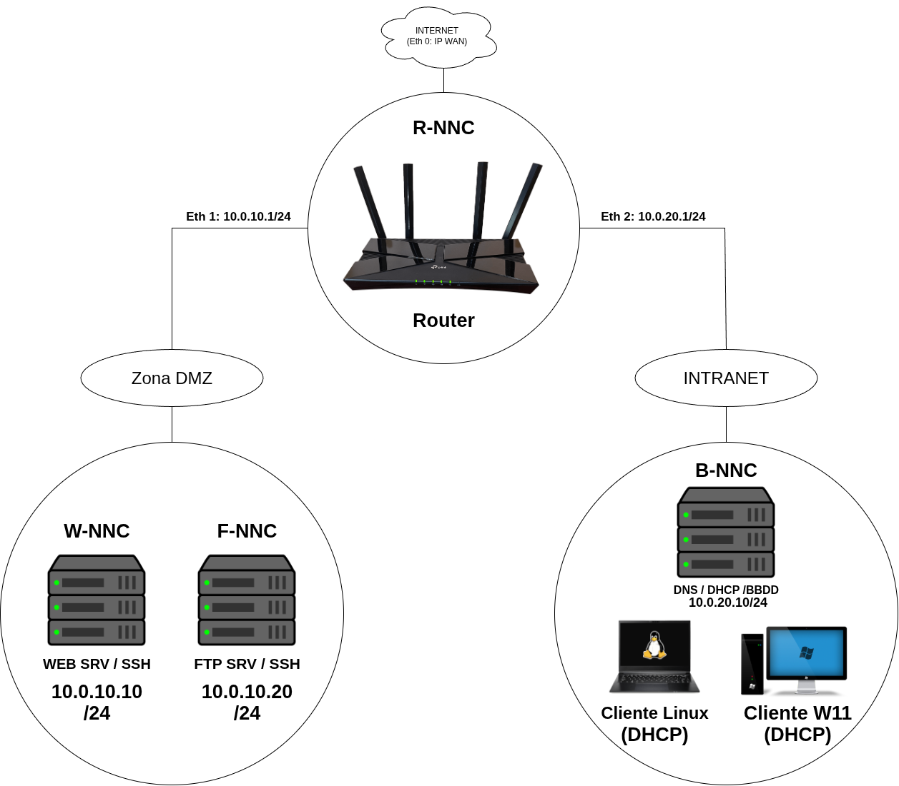
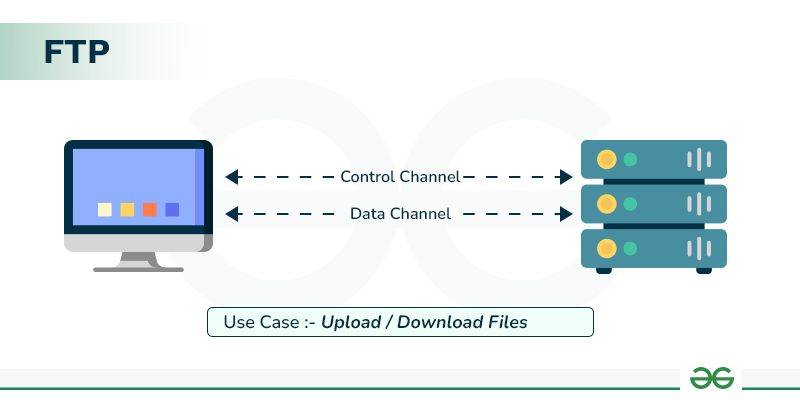

# Projecte-Zero

## Estructura de Red

*La red se estructura en torno a un router principal (R-NNC) configurado con tres interfaces de red independientes para cumplir con la segmentación requerida: NAT (WAN), DMZ e Intranet.*



## Índice

1. [Justificación técnica de la red](#justificación-técnica-de-la-estructura-y-componentes-de-red)
2. [Resumen y direccionamiento](#resumen-de-la-estructura-segregada)
3. [Firewalls y conexiones](#firewalls-y-conexiones)
4. [Configuración Web Server](#configuración-web-server)
5. [Configuración FTP Server](#configuración-ftp-server)
6. [Configuración B-NNC (BBDD, DNS, DHCP y SSH)](#configuración-b-nnc-bbdd-dns-dhcp-y-ssh)
7. [Configuración Router](#configuración-router)
8. [Control de versiones con Git y GitHub](#control-de-versiones-con-git-y-github)
9. [Pruebas](#pruebas)
10. [Problemas encontrados y cómo se arreglaron](#problemas-encontrados-y-cómo-se-arreglaron)
11. [Estructura del repositorio](#estructura-del-repositorio)

# Justificación Técnica de la Estructura y Componentes de Red

A continuación se explica la arquitectura de red, el papel de cada subred, interfaz y servidor.

## 1. Router / Puerta de Enlace (`R-NNC`)

* **Función y rol:** es el elemento central de encaminamiento y la frontera de seguridad entre Internet y las redes privadas.
* **Interfaces:**
  * **`Eth 0` (IP WAN / INTERNET):** sale a Internet mediante NAT. Protege la topología privada de ataques externos directos.
  * **`Eth 1` (`10.0.10.1/24`):** puerta de enlace de la **Zona DMZ** (`10.0.10.0/24`).
  * **`Eth 2` (`10.0.20.1/24`):** puerta de enlace de la **INTRANET** (`10.0.20.0/24`).
* **Seguridad:** separa el tráfico público del privado y permite aplicar reglas de cortafuegos para restringir el acceso desde la DMZ hacia la INTRANET, de forma que un servidor público comprometido no comprometa la red privada.

## 2. Zona DMZ (Demilitarized Zone), subred `10.0.10.0/24`

Aísla los servidores que deben ser accesibles desde fuera, para minimizar el impacto de posibles vulnerabilidades.

### A. Servidor WEB (`W-NNC`)
* **IP:** `10.0.10.10/24`
* **Servicios:** web (nginx) y SSH
* **Por qué en la DMZ:** aloja contenido público, así que tiene que estar separado de la base de datos y de los clientes.
* La web muestra la aplicación que consulta los datos de equipamiento educativo de Barcelona.

### B. Servidor FTP (`F-NNC`)
* **IP:** `10.0.10.20/24`
* **Servicios:** FTP y SSH
* **Por qué en la DMZ:** FTP expone un servicio de archivos que tiene que quedar fuera de la INTRANET para evitar que un problema se propague a la red local.

## 3. Zona INTRANET (red privada), subred `10.0.20.0/24`

Es el núcleo privado: servicios de infraestructura interna y equipos de usuario.

### A. Servidor de base de datos y servicios (`B-NNC`)
* **IP:** `10.0.20.10/24`
* **Servicios:** MySQL, DNS, DHCP y SSH
* **Por qué en la INTRANET:** la base de datos queda protegida de accesos directos desde Internet y desde la DMZ. Solo el servidor web hace consultas autorizadas por el puerto 3306.
* DHCP da IP, máscara, gateway y DNS a los clientes. DNS resuelve los nombres locales y reenvía el resto a servidores externos.

### B. Cliente Linux
Configuración dinámica por DHCP. Recibe IP en el rango `10.0.20.X` desde `B-NNC`.

### C. Cliente Windows 11 (`W11`)
Configuración dinámica por DHCP. Sirve para comprobar que DHCP, DNS y el servicio web funcionan también con Windows.

## Resumen de la Estructura Segregada

| Zona | Subred / rango | Propósito | Máquinas |
| :--- | :--- | :--- | :--- |
| WAN / NAT | Asignada por el proveedor | Salida a Internet | Interfaz `Eth 0` de `R-NNC` |
| DMZ | `10.0.10.0/24` | Servicios públicos | `W-NNC` (`10.0.10.10`) y `F-NNC` (`10.0.10.20`) |
| INTRANET | `10.0.20.0/24` | Infraestructura y puestos de trabajo | `B-NNC` (`10.0.20.10`), cliente Linux y cliente W11 |

### Tabla de direccionamiento IP y configuración

| Hostname | Zona | IP/Subred | Servicios | Notas y credenciales |
| --- | --- | --- | --- | --- |
| R-NNC | WAN/DMZ/INTRANET | WAN: DHCP, DMZ: 10.0.10.1/24, INTRANET: 10.0.20.1/24 | Router, enrutamiento, NAT | El DNS resuelve R-NNC, R-NCC y R a este equipo |
| W-NNC | DMZ | 10.0.10.10/24 | Servidor web, SSH | Usuario: bchecker / Pw: bchecker121 |
| F-NNC | DMZ | 10.0.10.20/24 | Servidor FTP, SSH | Usuario: bchecker / Pw: bchecker121 |
| B-NNC | INTRANET | 10.0.20.10/24 | MySQL, DNS, DHCP, SSH | Importa el CSV de datos. Usuario: bchecker / Pw: bchecker121 |
| PC-W11 | INTRANET | Dinámica (DHCP) | Cliente Windows | IP por DHCP |
| PC-Linux | INTRANET | Dinámica (DHCP) | Cliente Linux | IP por DHCP |

Las credenciales son las que da el enunciado y son solo para el entorno de laboratorio.

### Flujo de interconexión

1. **Resolución de nombres:** el DNS de B-NNC resuelve R-NNC, R-NCC y R hacia la IP del router.
2. **Web a BBDD:** la aplicación web en W-NNC (10.0.10.10) consulta MySQL en B-NNC (10.0.20.10) por el puerto 3306, cruzando el router.
3. **Administración:** todas las máquinas tienen cuenta SSH con `bchecker` para despliegue y administración.

## Firewalls y conexiones

Matriz de conectividad entre zonas (origen en filas, destino en columnas). La política por defecto del router es **denegar** todo lo que no esté permitido, y siempre se acepta el tráfico de respuesta de conexiones ya establecidas (`ESTABLISHED, RELATED`).

| Origen \ Destino | Internet | DMZ | LAN |
| --- | --- | --- | --- |
| **Internet** | - | Sí, solo servicios públicos (HTTP a `W-NNC`, FTP a `F-NNC`) | No |
| **DMZ** | Sí | - | Solo `W-NNC` → `B-NNC` (3306/tcp) |
| **LAN** | Sí (con NAT) | Sí (web, FTP y administración por SSH) | - |

Justificación de las reglas:

* **Internet → DMZ (restringido):** solo se exponen los puertos de los servicios públicos. El resto, SSH incluido, no es accesible desde fuera.
* **Internet → LAN (No):** la intranet no es accesible desde fuera y además está detrás de NAT.
* **DMZ → LAN (solo `W-NNC` → `B-NNC` por 3306/tcp):** es la única excepción, porque la web consulta MySQL. Cualquier otro intento de la DMZ hacia la intranet se bloquea.
* **LAN → Internet (Sí, con NAT):** los clientes necesitan salida a Internet y `B-NNC` necesita reenviar consultas DNS externas y descargar paquetes.
* **LAN → DMZ (Sí):** los clientes usan la web y el FTP, y desde la intranet se administran por SSH los servidores de la DMZ.
* **DMZ → Internet (Sí):** para actualizaciones y paquetes.

## Configuración Web Server


Configuración de Nginx:

```
events {
    worker_connections 1024;
}

http {
    server {
        listen 80;
        listen [::]:80;

        server_name sitioitb.cat;
        root /var/www/html/;
        index web.html web.htm;

        location / {
        try_files $uri $uri/ =404;
        }
    }
}
```

## Configuración FTP Server



## Configuración B-NNC (BBDD, DNS, DHCP y SSH)


B-NNC es una máquina Ubuntu Server 22.04 (jammy) en la intranet. Tiene MySQL, DNS, DHCP y SSH en el mismo sistema. Su interfaz `enp3s0` va conectada al router, a la interfaz de la INTRANET (`enp4s0` en el router, `10.0.20.1`).

El enunciado usa B-NNC y B-NCC indistintamente, por eso en `/etc/hosts` y en el DNS están los dos nombres.

### Script automático

Todo lo de esta sección está recogido en un script que se ejecuta con `sudo bash b-nnc.sh` (está en `scripts/b-nnc.sh`). Instala los paquetes, configura los servicios, descarga y carga el CSV, deja la IP fija y al final hace una batería de comprobaciones con `[OK]` / `[FAIL]`. Se puede ejecutar varias veces sin problema. Abajo está explicado paso a paso lo que hace.

### Sistema base y usuario

```
sudo hostnamectl set-hostname b-nnc
echo "127.0.1.1 b-nnc.sitioitb.cat b-nnc b-ncc" | sudo tee -a /etc/hosts

sudo useradd -m -s /bin/bash bchecker
echo "bchecker:bchecker121" | sudo chpasswd
sudo usermod -aG sudo bchecker
```

Paquetes (los servicios ya venían instalados, solo había que configurarlos):

```
sudo apt-get update
sudo apt-get install -y openssh-server bind9 bind9utils dnsutils isc-dhcp-server mysql-server git curl python3
```

### Red estática

Fichero `/etc/netplan/01-b-nnc.yaml`:

```
network:
  version: 2
  ethernets:
    enp3s0:
      dhcp4: no
      addresses: [10.0.20.10/24]
      routes:
        - to: default
          via: 10.0.20.1
      nameservers:
        addresses: [127.0.0.1]
        search: [sitioitb.cat]
```

```
sudo chmod 600 /etc/netplan/01-b-nnc.yaml
sudo netplan apply
ip -br a show enp3s0
ping -c2 10.0.20.1
```

Mientras tenía la IP por DHCP salía a Internet para instalar paquetes. Al poner la IP fija, la salida depende del router (ver [problemas](#problemas-encontrados-y-cómo-se-arreglaron)).

### SSH

```
sudo systemctl enable --now ssh
systemctl status ssh
```

Se entra con `bchecker`. Para GitHub se usa otra clave distinta, explicada en la sección de Git.

### DNS (bind9)

En Ubuntu 22.04 el servicio se llama `named` (`bind9` es solo un alias). El requisito del enunciado es que resuelva R-NCC y R hacia el router.

`/etc/bind/named.conf.options`:

```
options {
    directory "/var/cache/bind";
    listen-on { 127.0.0.1; 10.0.20.10; };
    allow-query { 127.0.0.1; 10.0.10.0/24; 10.0.20.0/24; };
    recursion yes;
    allow-recursion { 127.0.0.1; 10.0.10.0/24; 10.0.20.0/24; };
    forwarders { 8.8.8.8; 1.1.1.1; };
    dnssec-validation no;
};
```

`/etc/bind/named.conf.local`:

```
zone "sitioitb.cat" { type master; file "/etc/bind/db.sitioitb.cat"; };
zone "20.0.10.in-addr.arpa" { type master; file "/etc/bind/db.10.0.20"; };
zone "10.0.10.in-addr.arpa" { type master; file "/etc/bind/db.10.0.10"; };
```

Zona directa `/etc/bind/db.sitioitb.cat`:

```
$TTL 86400
@      IN SOA b-nnc.sitioitb.cat. admin.sitioitb.cat. ( 1 3600 900 604800 86400 )
@      IN NS  b-nnc.sitioitb.cat.
@      IN A   10.0.10.10
r      IN A   10.0.20.1
r-nnc  IN A   10.0.20.1
r-ncc  IN A   10.0.20.1
b-nnc  IN A   10.0.20.10
b-ncc  IN A   10.0.20.10
w-nnc  IN A   10.0.10.10
w-ncc  IN A   10.0.10.10
f-nnc  IN A   10.0.10.20
f-ncc  IN A   10.0.10.20
www    IN CNAME w-nnc
ftp    IN CNAME f-nnc
```

Las zonas inversas (`db.10.0.20` y `db.10.0.10`) tienen los registros PTR de `r-nnc`, `b-nnc`, `w-nnc` y `f-nnc`.

Un comodín tipo `*-nnc` no vale en DNS (el asterisco solo funciona como etiqueta completa), por eso los hosts están puestos uno a uno.

```
sudo named-checkconf
sudo named-checkzone sitioitb.cat /etc/bind/db.sitioitb.cat
sudo systemctl enable --now named
sudo systemctl restart named
```

### DHCP (isc-dhcp-server)

`/etc/default/isc-dhcp-server`:

```
INTERFACESv4="enp3s0"
```

`/etc/dhcp/dhcpd.conf`:

```
authoritative;
default-lease-time 600;
max-lease-time 7200;

subnet 10.0.20.0 netmask 255.255.255.0 {
    range 10.0.20.100 10.0.20.200;
    option routers 10.0.20.1;
    option domain-name-servers 10.0.20.10;
    option domain-name "sitioitb.cat";
    option broadcast-address 10.0.20.255;
}
```

```
sudo dhcpd -t -cf /etc/dhcp/dhcpd.conf
sudo systemctl enable --now isc-dhcp-server
```

Los clientes reciben IP entre `10.0.20.100` y `10.0.20.200`, gateway `10.0.20.1` y DNS `10.0.20.10`.

### MySQL y carga del CSV

MySQL 8. Para que la web de W-NNC pueda conectar, MySQL escucha en todas las interfaces. En `/etc/mysql/mysql.conf.d/mysqld.cnf`:

```
bind-address = 0.0.0.0
```

```
sudo systemctl enable --now mysql
sudo systemctl restart mysql
```

Base de datos y usuario (acceso desde local, DMZ e intranet):

```
SET GLOBAL local_infile = 1;
CREATE DATABASE equipaments CHARACTER SET utf8mb4;
CREATE USER 'bchecker'@'localhost' IDENTIFIED BY 'bchecker121';
CREATE USER 'bchecker'@'10.0.10.%' IDENTIFIED BY 'bchecker121';
CREATE USER 'bchecker'@'10.0.20.%' IDENTIFIED BY 'bchecker121';
GRANT ALL PRIVILEGES ON equipaments.* TO 'bchecker'@'localhost';
GRANT ALL PRIVILEGES ON equipaments.* TO 'bchecker'@'10.0.10.%';
GRANT ALL PRIVILEGES ON equipaments.* TO 'bchecker'@'10.0.20.%';
FLUSH PRIVILEGES;
```

CSV: listado de equipamientos de educación de la ciudad de Barcelona (Open Data BCN).

```
curl -L -o /tmp/equip.csv "https://opendata-ajuntament.barcelona.cat/data/dataset/f36b60f2-9541-4d08-b0f9-b0a9313fab3d/resource/29d9ff10-6892-4f16-9012-d5c4997857e7/download"
```

El fichero viene en UTF-16, así que antes de cargarlo hay que pasarlo a UTF-8 y limpiarlo:

```
iconv -f UTF-16 -t UTF-8 /tmp/equip.csv -o /tmp/equip_utf8.csv
mv /tmp/equip_utf8.csv /tmp/equip.csv
sed -i '1s/^\xEF\xBB\xBF//; s/\r$//' /tmp/equip.csv
```

La cabecera es `register_id,name,institution_id,institution_name,created,modified,addresses_roadtype_id,...`. Como el CSV tiene muchas columnas, un pequeño script de Python lee la cabecera, crea la tabla con todas las columnas como `TEXT` y genera el `LOAD DATA`:

```
python3 - <<'PY'
import csv, re
f = open('/tmp/equip.csv', encoding='utf-8')
hdr = next(csv.reader(f))
cols = []
for h in hdr:
    c = re.sub(r'[^a-z0-9]+', '_', h.strip().lower()).strip('_') or 'col'
    while c in cols:
        c += '_2'
    cols.append(c)
defs = ", ".join("`%s` TEXT" % c for c in cols)
names = ",".join("`%s`" % c for c in cols)
sql = "DROP TABLE IF EXISTS equipaments;\n"
sql += "CREATE TABLE equipaments (id INT AUTO_INCREMENT PRIMARY KEY, %s) CHARACTER SET utf8mb4;\n" % defs
sql += "LOAD DATA LOCAL INFILE '/tmp/equip.csv' INTO TABLE equipaments CHARACTER SET utf8mb4 "
sql += "FIELDS TERMINATED BY ',' OPTIONALLY ENCLOSED BY '\"' LINES TERMINATED BY '\\n' IGNORE 1 ROWS (%s);\n" % names
open('/tmp/load.sql', 'w').write(sql)
PY

mysql --local-infile=1 equipaments < /tmp/load.sql
```

Comprobación:

```
mysql -e "SELECT COUNT(*) FROM equipaments.equipaments;"
mysql -h 10.0.20.10 -u bchecker -pbchecker121 equipaments -e "SELECT name FROM equipaments LIMIT 5;"
ss -tln | grep 3306
```

## Configuración Router

Configuración del fichero `/etc/network/interfaces` para las tarjetas de red.

```
# This file describes the network interfaces available on your system
# and how to activate them. For more information, see interfaces(5).

source /etc/network/interfaces.d/*

# The loopback network interface
auto lo
iface lo inet loopback

# The primary network interface (INTERNET)
auto enp1s0
iface enp1s0 inet dhcp

#Conexión VPN Wireguard enp2s0 no hace falta

#Conexión DMZ

auto enp3s0
iface enp3s0 inet static
    address 10.0.10.1/24

#Conexión INTRANET

auto enp4s0
iface enp4s0 inet static
    address 10.0.20.1/24
```

Una vez escrita la configuración con sudo, ejecutamos `systemctl restart networking` para que se apliquen los ajustes en las tarjetas.

Ahora activamos el reenvío de paquetes:

```
echo "net.ipv4.ip_forward=1" | sudo tee /etc/sysctl.d/99-router.conf
sudo sysctl --system
```

Después instalamos nftables para configurar el cortafuegos junto al NAT en `/etc/nftables.conf` (se necesita sudo):

```
#!/usr/sbin/nft -f
flush ruleset

define WAN   = "enp1s0"
define DMZ   = "enp3s0"
define INTRA = "enp4s0"

define WEB  = 10.0.10.10   # W-NNC
define FTP  = 10.0.10.20   # F-NNC
define BNNC = 10.0.20.10   # B-NNC

table inet filter {
    chain input {
        type filter hook input priority filter; policy drop;
        ct state established,related accept
        ct state invalid drop
        iif lo accept
        ip protocol icmp accept
        ip6 nexthdr icmpv6 accept
        iifname $WAN udp sport 67 udp dport 68 accept
        # Administración del router solo desde la intranet
        iifname $INTRA tcp dport 22 accept
    }

    chain forward {
        type filter hook forward priority filter; policy drop;
        ct state established,related accept
        ct state invalid drop

        # Internet -> DMZ: solo los servicios publicados
        iifname $WAN oifname $DMZ ip daddr $WEB tcp dport { 80, 443 } accept
        iifname $WAN oifname $DMZ ip daddr $FTP tcp dport { 21, 40000-40100 } accept

        # Intranet -> DMZ e Internet (incluye SSH a los servidores)
        iifname $INTRA oifname { $WAN, $DMZ } accept

        # DMZ -> BBDD en B-NNC: solo el servidor web y solo ese puerto
        iifname $DMZ oifname $INTRA ip saddr $WEB ip daddr $BNNC tcp dport 3306 accept

        # DMZ -> Internet: solo lo necesario (DNS, NTP, actualizaciones, ping)
        iifname $DMZ oifname $WAN tcp dport { 53, 80, 443 } accept
        iifname $DMZ oifname $WAN udp dport { 53, 123 } accept
        iifname $DMZ oifname $WAN icmp type echo-request accept
    }
}

table ip nat {
    chain prerouting {
        type nat hook prerouting priority dstnat;
        iifname $WAN tcp dport { 80, 443 } dnat to $WEB
        iifname $WAN tcp dport { 21, 40000-40100 } dnat to $FTP
        # SSH desde fuera (opcional, descomenta si lo necesitas):
        # iifname $WAN tcp dport 2210 dnat to $WEB:22
        # iifname $WAN tcp dport 2220 dnat to $FTP:22
    }
    chain postrouting {
        type nat hook postrouting priority srcnat;
        oifname $WAN masquerade
    }
}
```

Lo aplicamos con `sudo nft -c -f /etc/nftables.conf` para comprobar la sintaxis y luego `sudo systemctl restart nftables` para cargar la configuración.

## Control de versiones con Git y GitHub

El proyecto está en un repositorio de GitHub. El servidor B-NNC se autentica con un par de claves pública/privada, sin contraseñas.

### Autenticación por clave SSH

En el servidor, con el usuario `bchecker`:

```
ssh-keygen -t ed25519 -C "b-nnc" -N "" -f ~/.ssh/id_ed25519
cat ~/.ssh/id_ed25519.pub
```

La clave pública (la línea entera que empieza por `ssh-ed25519`) se añade en GitHub, no en la terminal: repositorio, Settings, Deploy keys, Add deploy key, marcando "Allow write access". La clave privada no sale del servidor.

Comprobación:

```
ssh-keyscan -t ed25519 github.com >> ~/.ssh/known_hosts
ssh -T git@github.com
```

Tiene que responder con "successfully authenticated".

### Configuración inicial

```
git config --global user.name "bchecker"
git config --global user.email "bchecker@sitioitb.cat"
git config --global init.defaultBranch main
```

### Comandos principales

| Comando | Para qué sirve |
| --- | --- |
| `git clone git@github.com:USUARIO/projecte-zero.git` | descarga el repo la primera vez |
| `git status` | ver qué ha cambiado |
| `git add .` | preparar los cambios para el commit |
| `git commit -m "mensaje"` | guardar los cambios en local con un mensaje |
| `git push origin main` | subir los commits a GitHub |
| `git pull origin main` | bajar los cambios nuevos de GitHub |
| `git log --oneline` | ver el historial |

### Flujo de subida a producción

1. Se editan los ficheros (configuración, documentación, scripts).
2. `git add .` y `git commit -m "descripción del cambio"`.
3. `git push origin main` sube los cambios a GitHub.
4. En el servidor de producción se hace `git pull origin main` para actualizar.

Si el push se rechaza porque hay cambios nuevos en GitHub, primero `git pull --rebase origin main` y luego otra vez `git push`.

## Pruebas

### Servicios y puertos en B-NNC

```
systemctl is-active ssh named isc-dhcp-server mysql
ss -tln | grep -E ':22 |:3306 '
ss -uln | grep -E ':53 |:67 '
```

### Red

```
ip -br a show enp3s0      # 10.0.20.10/24
ping -c2 10.0.20.1        # router
ping -c2 8.8.8.8          # salida a Internet
ping -c2 google.com       # DNS recursivo
```

### DNS

```
dig +short r.sitioitb.cat @10.0.20.10        # 10.0.20.1
dig +short r-ncc.sitioitb.cat @10.0.20.10    # 10.0.20.1
dig +short w-nnc.sitioitb.cat @10.0.20.10    # 10.0.10.10
dig +short -x 10.0.20.1 @10.0.20.10          # r-nnc.sitioitb.cat.
```

### DHCP

Arrancar PC-Linux y PC-W11 en la intranet y comprobar que reciben IP entre 10.0.20.100 y 10.0.20.200, gateway 10.0.20.1 y DNS 10.0.20.10. En Linux con `ip a` y `resolvectl status`, en Windows con `ipconfig /all`. Los leases se ven en `/var/lib/dhcp/dhcpd.leases`.

### MySQL

```
mysql -e "SELECT COUNT(*) FROM equipaments.equipaments;"
mysql -h 10.0.20.10 -u bchecker -pbchecker121 equipaments -e "SELECT COUNT(*) FROM equipaments;"
```

Desde W-NNC, la aplicación web tiene que poder conectar a `10.0.20.10:3306` y mostrar el contenido de la tabla `equipaments`.

### Git

```
ssh -T git@github.com
git -C ~/projecte-zero status
git -C ~/projecte-zero push
```

## Problemas encontrados y cómo se arreglaron

### `systemctl enable bind9` falla

Error: `Refusing to operate on alias name or linked unit file: bind9.service`.
Causa: en Ubuntu 22.04 `bind9` es un alias del servicio `named`.
Solución: usar `systemctl enable --now named` (y `restart named`).

### El CSV da error de codificación

Error de Python: `UnicodeDecodeError: 'utf-8' codec can't decode byte 0xff`.
Causa: el CSV de Open Data BCN viene en UTF-16.
Solución: convertirlo con `iconv -f UTF-16 -t UTF-8` antes de cargarlo.

### Sin Internet después de poner la IP estática

Síntomas: `apt-get update` da `Network is unreachable` y los repositorios no tienen Release file.
Causa: con la IP estática `10.0.20.10` la salida depende del router (`10.0.20.1`), que tiene que reenviar paquetes y hacer NAT.
Solución: comprobar con ping a `10.0.20.1`, `8.8.8.8` y `google.com`. En el router tiene que estar `net.ipv4.ip_forward=1` y la regla `masquerade` de nftables en la interfaz WAN, además de la regla de forward de la intranet hacia la WAN.

### Pegar la clave pública en la terminal

La línea `ssh-ed25519 AAAA...` no es un comando. Se pega en GitHub (Deploy keys), no en la terminal, porque ahí da `command not found`.

## Estructura del repositorio

```
projecte-zero/
├── README.md              esta documentación
├── Imagenes/              esquema de red y gifs de los servicios
│   ├── RedProyecto.png
│   ├── webserver.gif
│   ├── ftpserver.gif
│   └── db_dns_dhcp_server.gif
└── scripts/
    └── b-nnc.sh           configuración automática de B-NNC
```
