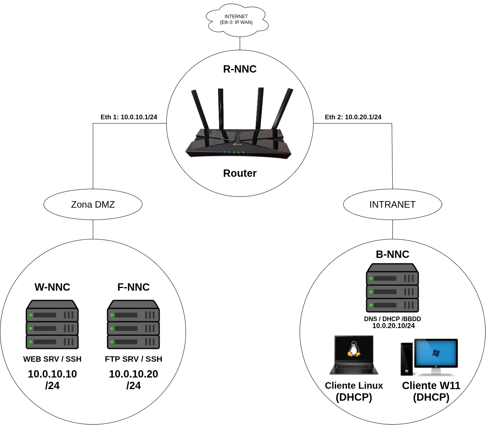
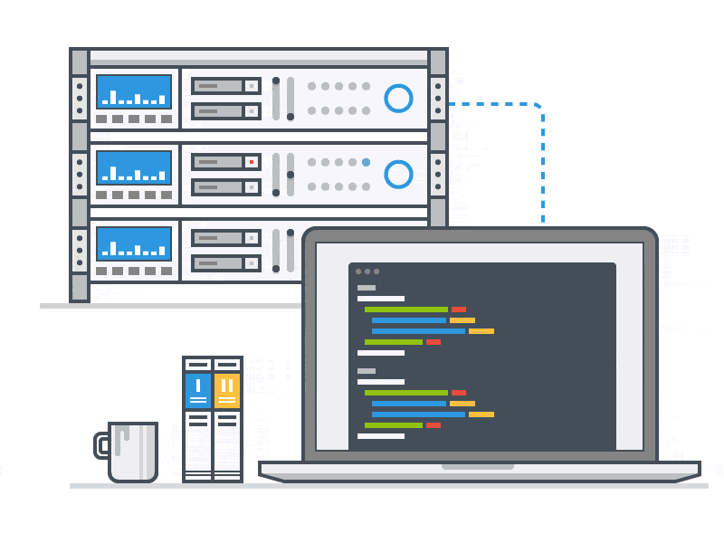
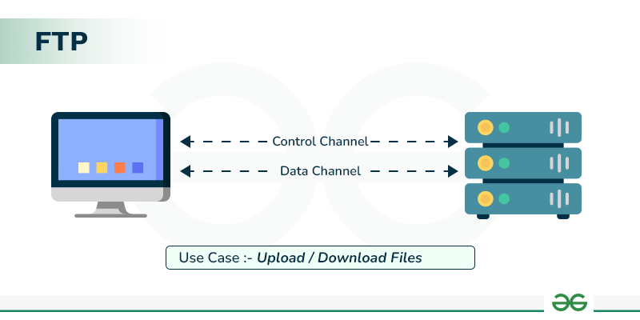

# Projecte-Zero

## Estructura de Red

*La red se estructura en torno a un router principal (R-NCC) configurado con tres interfaces de red independientes para cumplir con la segmentación requerida: NAT (WAN), DMZ e Intranet.*

### Distribución de Zonas y Servicios

1. **Zona NAT / WAN:** Conecta el router a la red externa/Internet, permitiendo la salida de tráfico mediante traducción de direcciones.
2. **Zona DMZ (Demilitarized Zone):** Aloja los servicios accesibles públicamente o expuestos.
    * **Servidor WEB (W-NNC):** Muestra la interfaz de la aplicación que consulta los datos.
    * **Servidor FTP (F-NNC):** Gestiona la transferencia de archivos.
3. **Servidor de Base de Datos y Servicios (B-NCC):** Ejecuta el motor MySQL con el conjunto de datos de equipamiento educativo de Barcelona, además del servidor DNS y DHCP.
4. **Clientes:** Dos ordenadores locales (uno con SO Windows y otro con SO Linux).

### Tabla de Direccionamiento IP y Configuración

| Hostname  | Zona de Red         | Dirección IP/Subred                                         | Servicios y Funciones       | Notas y Credenciales
| --------- |---------------------|-------------------------------------------------------------|-----------------------------|:-------------------------------------------------------------:|
| R-NNC     | WAN/DMZ/INTRANET    | WAN: IP por DHCP, DMZ: 10.0.10.1/24, INTRANET: 10.0.20.1/24 | Router / Enrutamiento / NAT | DNS resuelve R-NCC y *-NNC a este equipo.                     |
| W-NNC     | DMZ                 | 10.0.10.10/24                                               | Servidor Web, SSH           | Usuario: bchecker / Pw: bchecker121                           |
| F-NNC     | DMZ                 | 10.0.10.20/24                                               | Servidor FTP, SSH           | Usuario: bchecker / Pw: bchecker121                           |
| B-NNC     | INTRANET            | 10.0.20.10/24                                               | MySQL, DNS, DHCP, SSH       | Importa el CSV de datos. Usuari: bchecker / Pw: bchecker121   |
| PC-W11    | INTRANET            | Dinámica (DHCP)                                             | Cliente Windows             | Configuración IP por DHCP.                                    |
| PC-Linux  | INTRANET            | Dinámica (DHCP)                                             | Cliente Linux               | Configuración IP por DHCP.                                    |

### Flujo de Interconexión

1. **Resolución de Nombres:** El servidor DNS en B-NCC resuelve los nombres R-NCC y R hacia la IP del router.
2. **Conexión Web - BBDD:** La aplicación web en W-NCC (10.0.10.10) realiza peticiones al motor MySQL en B-NCC (10.0.20.10) cruzando el router a través del puerto 3306.
3. **Gestión y Acceso Administrado:** Todos los servidores y máquinas disponen de cuenta SSH configurada con la credencial bchecker / bchecker121 para tareas de despliegue y administración.

## Configuración Web Server

## Configuración FTP Server

## Configuración DDBB, DNS y DHCP Server (Todo junto en el mismo sistema)

