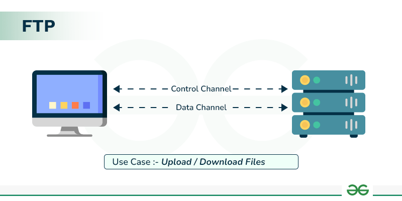

# Servidor FTP F-NNC



| Campo | Valor |
| :--- | :--- |
| Hostname | `f-nnc` (alias `f-ncc` y `f-nnc.sitioitb.cat`) |
| Sistema | Ubuntu Server 24.04 LTS |
| Zona | DMZ `10.0.10.0/24` |
| IP | `10.0.10.20/24` (interfaz `enp2s0`) |
| Puerta de enlace | `R-NNC` (`10.0.10.1`) solo para la INTRANET; la ruta por defecto sale por `enp1s0` (ver [riesgos](../gestion.md#riesgos-técnicos-y-mejoras)) |
| Servicios | FTP/FTPS (`vsftpd`) y SSH |
| Usuario | `bchecker` / `bchecker121` |

## Configuración de red de F-NNC

| Interfaz | IP | Uso |
| :--- | :--- | :--- |
| `enp1s0` | DHCP | Salida a Internet (NAT de la plataforma de virtualización) |
| `enp2s0` | `10.0.10.20/24` | DMZ, conectada a `R-NNC` |

Se añade una ruta estática hacia la INTRANET a través del router. Así, los clientes de `10.0.20.0/24` pueden usar el FTP y la respuesta vuelve por `R-NNC` en lugar de intentar salir por otra interfaz.

```yaml
# /etc/netplan/60-static-enp2s0.yaml
network:
  version: 2
  ethernets:
    enp2s0:
      addresses:
        - 10.0.10.20/24
      routes:
        - to: 10.0.20.0/24
          via: 10.0.10.1
```

```bash
sudo chmod 600 /etc/netplan/*.yaml
sudo netplan apply
ip -br a show enp2s0
ping -c2 10.0.10.1
```

## Sistema base y usuario de F-NNC

```bash
sudo hostnamectl set-hostname f-nnc
sudo sed -i 's/^127\.0\.1\.1.*/127.0.1.1 f-nnc.sitioitb.cat f-nnc f-ncc/' /etc/hosts

sudo useradd -m -s /bin/bash bchecker
echo "bchecker:bchecker121" | sudo chpasswd
sudo usermod -aG sudo bchecker
```

## Acceso SSH a F-NNC

```bash
sudo apt-get install -y openssh-server
sudo systemctl enable --now ssh
```

Administración remota desde la INTRANET:

```bash
ssh bchecker@10.0.10.20
```

## Instalación y configuración de vsftpd

```bash
sudo apt-get install -y vsftpd
sudo cp /etc/vsftpd.conf /etc/vsftpd.conf.orig
```

```ini
# /etc/vsftpd.conf  -  F-NNC
listen=NO
listen_ipv6=YES
anonymous_enable=NO
local_enable=YES
write_enable=YES
local_umask=022
dirmessage_enable=YES
use_localtime=YES
xferlog_enable=YES
connect_from_port_20=YES
ftpd_banner=Servidor FTP F-NNC

# Cada usuario encerrado en su home
chroot_local_user=YES
allow_writeable_chroot=YES
secure_chroot_dir=/var/run/vsftpd/empty
pam_service_name=vsftpd

# Modo pasivo (rango abierto/redirigido en el router R-NNC)
pasv_enable=YES
pasv_min_port=40000
pasv_max_port=40100
pasv_address=10.0.10.20

# Solo los usuarios de la lista pueden entrar
userlist_enable=YES
userlist_file=/etc/vsftpd.userlist
userlist_deny=NO

# FTPS explícito opcional (TLS)
ssl_enable=YES
allow_anon_ssl=NO
force_local_logins_ssl=NO
force_local_data_ssl=NO
ssl_tlsv1=YES
ssl_sslv2=NO
ssl_sslv3=NO
require_ssl_reuse=NO
rsa_cert_file=/etc/ssl/certs/ssl-cert-snakeoil.pem
rsa_private_key_file=/etc/ssl/private/ssl-cert-snakeoil.key
```

Alta del usuario en la lista blanca, contenido de prueba y arranque del servicio:

```bash
echo bchecker | sudo tee /etc/vsftpd.userlist

sudo mkdir -p /home/bchecker/ftp
echo "Fitxer de prova F-NNC" | sudo tee /home/bchecker/ftp/benvinguda.txt
sudo chown -R bchecker:bchecker /home/bchecker/ftp

sudo systemctl enable --now vsftpd
sudo systemctl restart vsftpd
```

## Decisiones de configuración

| Opción | Motivo |
| :--- | :--- |
| `anonymous_enable=NO` | El servidor está en la DMZ, expuesto a Internet: no se permite el acceso anónimo. |
| `chroot_local_user=YES` | Cada usuario queda encerrado en su home y no puede ver el resto del sistema. |
| `allow_writeable_chroot=YES` | vsftpd se niega a encerrar a un usuario en un directorio en el que puede escribir; esta opción lo permite, porque el home de `bchecker` es escribible. |
| `userlist_deny=NO` | Lista blanca: solo entran los usuarios incluidos en `/etc/vsftpd.userlist`. |
| `pasv_min_port` / `pasv_max_port` (`40000`-`40100`) | Rango acotado para poder abrirlo y redirigirlo en el firewall de `R-NNC`. |
| `pasv_address=10.0.10.20` | IP de la DMZ que el servidor anuncia a los clientes en modo pasivo. |
| `ssl_enable=YES` sin forzar | Permite FTPS (TLS explícito) sin impedir el uso de clientes FTP simples. |

Con los clientes de la INTRANET solo funciona el **modo pasivo**: en modo activo es el servidor quien abre la conexión de datos hacia el cliente, y `R-NNC` no deja pasar conexiones iniciadas desde la DMZ hacia la INTRANET.

## Alta de nuevos usuarios FTP

Para un usuario que solo use el FTP, sin shell interactiva:

```bash
sudo useradd -m -s /usr/sbin/nologin usuario2
sudo passwd usuario2
echo usuario2 | sudo tee -a /etc/vsftpd.userlist
sudo mkdir -p /home/usuario2/ftp
sudo chown usuario2:usuario2 /home/usuario2/ftp
```

- Hay que usar `tee -a` (añadir al final). Sin `-a`, `tee` sobrescribe la lista y los usuarios que ya estaban dejan de poder entrar.
- Si `grep pam_shells /etc/pam.d/vsftpd` devuelve una línea, PAM solo deja entrar a usuarios cuya shell aparece en `/etc/shells`. En ese caso hay que añadir `/usr/sbin/nologin` a ese fichero: `grep -x /usr/sbin/nologin /etc/shells || echo /usr/sbin/nologin | sudo tee -a /etc/shells`.

## Comprobación de F-NNC

Desde un cliente de la INTRANET:

```bash
# Listar y descargar
curl -u bchecker:bchecker121 ftp://10.0.10.20/ftp/
curl -u bchecker:bchecker121 ftp://10.0.10.20/ftp/benvinguda.txt

# Subida por FTPS (-k acepta el certificado autofirmado)
curl --ssl-reqd -k -u bchecker:bchecker121 -T fitxer.txt ftp://10.0.10.20/ftp/

# Acceso anónimo (debe fallar)
curl ftp://10.0.10.20/
```

En el propio servidor:

```bash
hostname
ip r | grep 10.0.20
ss -ltnp | grep -E ':(21|22)\s'
systemctl is-active vsftpd ssh
```

| Prueba | Resultado esperado |
| :--- | :--- |
| Inicio de sesión de `bchecker` y listado | Correcto |
| Descarga de `benvinguda.txt` | Correcto |
| Subida con FTPS (TLS) | Correcto |
| Acceso anónimo | Rechazado |
| Chroot (en `/` solo se ve `ftp/`) | Correcto |
| Puertos 21 y 22 escuchando | Correcto |
| Ping al router `10.0.10.1` | Correcto |

## Dependencias de F-NNC con otros equipos

| Equipo | Requisito |
| :--- | :--- |
| `R-NNC` | El firewall debe permitir y redirigir `21/tcp` y `40000-40100/tcp` hacia `10.0.10.20`. |
| `B-NNC` | El DNS debe resolver `f-nnc` y `f-ncc` hacia `10.0.10.20`, y definir `ftp IN CNAME f-nnc`. |

El certificado TLS es el autofirmado de Ubuntu (`snakeoil`), por lo que los clientes mostrarán un aviso al usar FTPS. Para que puedan comprobar que el certificado es el bueno, el administrador les facilita su huella SHA-256:

```bash
openssl x509 -in /etc/ssl/certs/ssl-cert-snakeoil.pem -noout -fingerprint -sha256
```

---

[Volver al índice](../../README.md)
